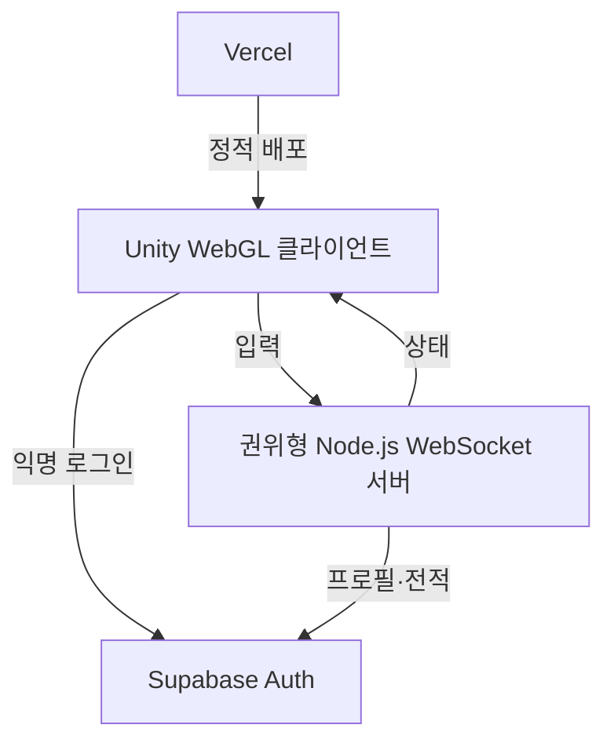

# Pop Pop Arena

귀여운 탐험대가 `팝 오브`를 설치해 길을 열고 상대를 버블에 가두는, **브라우저에서 플레이 가능한 독자 IP 4대4 대전 POC**입니다.

10~20대와 어린이·여성 사용자가 짧은 시간에 부담 없이 즐길 수 있도록, 한 판 2분·간단한 터치 조작·즉시 재도전 흐름을 목표로 합니다.

> 이 프로젝트는 특정 기존 게임의 명칭, 캐릭터, 맵, 그래픽, 사운드, UI 또는 기타 자산을 사용하지 않습니다. 현재의 모든 시각 요소는 게임 규칙 검증을 위한 임시 도형입니다.

## 현재 구현 범위

| 영역 | 포함된 기능 |
| --- | --- |
| 로컬 전투 | 격자 이동, 파괴 블록, 오브 설치, 4방향 웨이브, 연쇄 점화, 아이템, 버블 탈락, 120초 경기 |
| 모바일 UX | 시작·결과 화면, 화면 하단 가상 방향키, `POP` 설치 버튼 |
| 온라인 대전 | 1대1 또는 4대4 룸, 캐릭터·스킨·맵 선택, 서버 권위 이동·오브·웨이브·아이템·버블·아군 구조·승패 판정 |
| 계정·전적 | Supabase 익명 로그인, JWT 검증, 프로필·경기 결과 스키마 및 서버 전용 저장 경계 |

## 구조



- **Unity 6 LTS:** 게임 화면, 터치/키보드 입력, 서버 상태 렌더링
- **Node.js + ws:** 룸과 전투 규칙을 소유하는 권위형 서버
- **Supabase:** 인증, 프로필, 랭크·전적 데이터
- **Vercel:** Unity WebGL 빌드와 소개·초대 페이지의 정적 배포

## 빠른 시작

### 브라우저 POC (Unity 설치 없이 실행)

Node.js 22 이상에서 다음 명령을 실행합니다.

```bash
cd Server
npm ci
npm run poc
```

브라우저에서 `http://localhost:8080`을 엽니다. 캐릭터·스킨·맵과 `4 vs 4 · 8명`을 선택하고 같은 초대방 이름으로 8개 탭에서 입장하면 시작합니다. 인원이 모이기 전에는 대기합니다. 빠른 2인 확인에는 `1 vs 1 · 2명`을 선택합니다. 방향키/WASD로 이동하고 Space로 물폭탄을 놓습니다. 모바일에서는 화면 방향 버튼과 POP 버튼을 사용합니다. 모든 맵에 아이템전이 적용되며 버블 아군 옆으로 이동하면 구조됩니다.

`npm run poc`는 로컬 개발 게스트 모드이며 인증·전적 저장은 사용하지 않습니다. 기본적으로 로컬 기기에서만 접속 가능합니다. LAN 테스트가 필요하면 서버 프로세스에 `HOST=0.0.0.0`을 명시하고 접근 가능한 서버 주소를 사용합니다. 공개 서비스는 아래 Supabase 설정을 채우고 `ALLOW_DEV_GUESTS=false`로 `npm start`를 실행해야 합니다. HTTP와 WebSocket을 함께 제공하므로 HTTPS/WSS 종료가 가능한 서버에 배포합니다. 브라우저는 `/api/config`에서 URL과 공개 anon 키만 받으며 서비스 역할 키는 서버에만 있습니다.

[POC 완료 기준과 테스트 방법](docs/Design/POC-Acceptance.md)을 참고하세요. 기존 Unity 클라이언트도 동일한 서버를 사용하며 아래 방식으로 별도 빌드할 수 있습니다.

### 로컬 전투

1. Unity Hub에서 Unity 6 LTS 프로젝트로 이 폴더를 엽니다.
2. 빈 씬을 만들고 빈 GameObject에 `ArenaBootstrap`을 추가합니다.
3. Play를 실행합니다.

| 플레이어 | 이동 | 오브 설치 |
| --- | --- | --- |
| P1 | `W` `A` `S` `D` | `Space` |
| P2 | 방향키 | `Right Control` |

모바일/웹 터치에서는 시작 뒤 화면 하단의 방향 버튼과 `POP` 버튼을 사용합니다.

### 온라인 1대1 / 4대4

```bash
cd Server
npm ci
npm start
```

Unity의 `ArenaBootstrap` GameObject에 다음 컴포넌트를 추가합니다.

1. `WebGlSocketClient` — 서버 URL, 방 ID, 닉네임과 팀 모드 설정. 방 ID가 비어 있으면 맵별로 팀전은 `team-quick-<mapId>`, 1대1은 `quick-<mapId>`을 사용합니다.
2. `NetworkArenaRenderer` — 같은 `WebGlSocketClient`와 `ArenaGrid` 연결
3. `SupabaseAnonymousLogin` — Supabase 프로젝트 URL과 공개 anon 키, 같은 `WebGlSocketClient` 설정
4. `OnlineInputRouter` — 같은 `WebGlSocketClient` 연결 (`ArenaBootstrap`이 컴포넌트를 자동 추가)

WebGL 빌드를 실행하면 익명 로그인 후 선택 화면에서 캐릭터, 스킨과 맵을 고르고 온라인으로 입장할 수 있습니다. 첫 참가자가 정한 맵과 다른 맵을 선택한 참가자는 입장이 거부됩니다. 팀전은 8명이 모이면 시작합니다. 운영 환경에서는 `wss://` 주소를 사용합니다. 직접 개발용 게스트를 이용한다면 서버 환경에 `ALLOW_DEV_GUESTS=true`를 지정하고, 연결 전에 토큰 없이 `Connect()`를 호출해야 합니다. 공개 서버에서는 `false`로 둡니다.

## Supabase 설정

1. Supabase SQL Editor에서 [`Supabase/schema.sql`](Supabase/schema.sql)을 실행합니다.
2. [`Supabase/migrations/20261102_team_match_history.sql`](Supabase/migrations/20261102_team_match_history.sql)을 SQL Editor에서 적용합니다. 기존 데이터베이스에도 이 마이그레이션이 필요합니다. 참가자별 결과를 기록하고 방 이름을 재사용할 수 있게 합니다.
3. Authentication 설정에서 **Anonymous sign-ins**를 활성화합니다.
4. [`Server/.env.example`](Server/.env.example)을 참고해 WebSocket 서버의 프로세스 환경변수를 설정합니다. 서버는 `.env` 파일을 자동으로 읽지 않습니다.
5. Unity `SupabaseAnonymousLogin`에도 프로젝트 URL과 공개 anon 키를 설정합니다.

| 변수 | 위치 | 용도 |
| --- | --- | --- |
| `SUPABASE_URL` | 서버 | Supabase 프로젝트 URL |
| `SUPABASE_ANON_KEY` | 서버·Unity | 익명 로그인 및 JWT 검증용 공개 키 |
| `SUPABASE_SERVICE_ROLE_KEY` | 서버만 | 프로필·전적 기록 |
| `ALLOW_DEV_GUESTS` | 서버 | 로컬 개발용 우회. 공개 테스트/운영에서는 `false` |

`SUPABASE_SERVICE_ROLE_KEY`는 Unity WebGL, Vercel 정적 파일, 저장소에 절대 넣지 않습니다.

익명 세션은 브라우저 `sessionStorage`를 이용하므로 같은 탭에서만 재사용됩니다. 탭을 닫거나 저장소가 지워지면 기존 익명 계정과 전적을 다시 찾지 못할 수 있습니다. 장기적인 계정 보존을 위해서는 향후 계정 연결 기능이 필요하며 현재 구현되어 있지 않습니다. 인증된 사용자의 프로필 저장이 실패하면 서버는 `profile_unavailable` 오류를 반환하고 방 입장을 거부합니다.

## 주요 폴더

```text
Server/public/ 브라우저 POC 클라이언트
Assets/       Unity 게임·UI·WebGL 브리지 코드
Server/       권위형 WebSocket 게임 서버
Supabase/     데이터베이스 스키마
docs/         MVP 설계와 실시간 프로토콜
```

## 다음 작업

- 독자 IP 캐릭터·맵·이펙트·사운드 자산 적용
- 안전 구역 및 실제 8인 WebGL 경기 검증
- 매칭, 랭킹, 전적 화면 및 운영 도구 추가
- WebGL 빌드 자동화와 Vercel/게임 서버 배포

## 검증과 현재 제한

```bash
cd Server
node --test test/*.test.js
cd ..
node --test Assets/Tests/*.test.cjs
# Python Playwright + Chromium 설치 환경
python3 scripts/browser-smoke.py
```

온라인 아이템은 파괴 블록에서 서버가 드롭합니다. `orb`는 설치 수(최대 5), `wave`는 파동 범위(최대 7)를 늘리고, `dash`는 한 입력에 최대 두 칸 이동, `pin`은 다음 피격을 한 번 막습니다. 같은 팀의 버블에 갇힌 플레이어 곁으로 이동하면 구조합니다.

브라우저 캐릭터는 코드로 그린 독자 캐릭터이며 스킨·맵별 외형을 구분합니다. Unity 캐릭터는 임시 도형이며 모든 캐릭터의 능력치는 같습니다. 팀·1대1 방과 선택, 아이템 규칙은 서버 자동 테스트를 제공합니다. 브라우저 POC는 실제 Chromium 8세션에서 입장·키보드·물폭탄·구출·팀 결과를 검증합니다. Unity 편집기를 이용한 빌드와 실제 Supabase 전적 저장은 별도 환경에서 검증해야 합니다. 자동 매칭, 재접속과 본격적인 전적 UI는 아직 없습니다.
