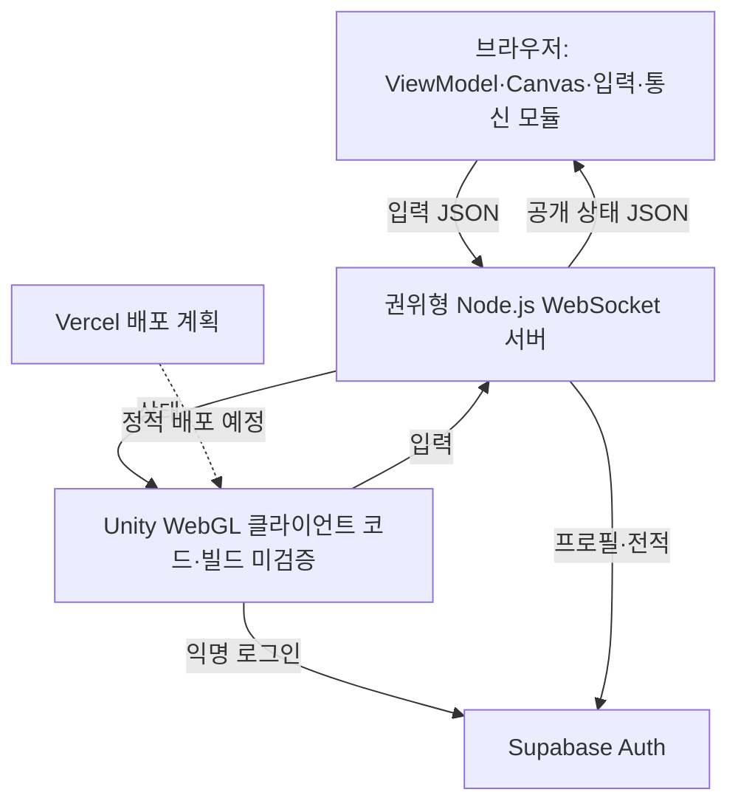

# Pop Pop Arena

> **2026-11-07 사용성 수정:** 시작·회원·로비·캐릭터·맵·대기·대전·결과를 별도 화면으로 분리했습니다. 기존80~85점대 수치는 구현 중심 설계 평가였으며 실제 공개 서비스의 완성도를 대표하지 않습니다. 사용자의 공개 플레이 평가는 약30점이었고, 이번에는 [실제 사용 흐름과 남은 설정](docs/Design/Game-Shell-Accounts-2026-11-07.md)을 기준으로 확인합니다.

귀여운 탐험대가 `팝 오브`를 설치해 길을 열고 상대를 버블에 가두는, **브라우저에서 플레이 가능한 독자 IP 4대4 대전 POC**입니다.

친구와 짧게 한두 판 즐기려는 초보·캐주얼 사용자를 위해, 한 판 2분·키보드/터치 조작·단계별 훈련·소규모 친구+AI 팀전을 제공합니다. 성별·연령별 선호는 아직 사용자 조사로 검증하지 않았습니다.

> 캐릭터와 맵은 독자 디자인입니다. 브라우저 맵은 테마별 SVG 이미지 타일을 사용하며, Unity 화면은 임시 도형을 사용합니다.

## 현재 구현 범위

| 영역 | 포함된 기능 |
| --- | --- |
| 로컬 전투 | 격자 이동, 파괴 블록, 오브 설치, 4방향 웨이브, 연쇄 점화, 아이템, 버블 탈락, 120초 경기 |
| 모바일 UX | 시작·결과 화면, 가상 방향키, `POP`·다트·패스 버튼, 개인 점수·능력치 표시, 가로 화면·글자 크기·집중 모드 |
| 온라인 대전 | 1대1 또는 4대4 룸, 캐릭터·스킨·맵 선택, 아이템전 ON/OFF, 클래식/팝 릴레이/하모니, 서버 권위 전투·구출·다트·승패, 초대 링크·동일방 재대결 |
| 연결 복구 | 브라우저의 30초 자리 보존·자동 재연결·같은 탭 새로고침 복귀, 계정 재검증, 명시적 나가기 |
| 계정·전적 | 브라우저 이메일 회원가입·로그인·세션 갱신·로그아웃, JWT 검증, 내 프로필·최근 경기·등급·순위, 서버 전용 K32 팀 Elo 집계 |
| 회원 내역 | 본인만 조회하는 경기·결제 기록, 닉네임 수정, 회원 세션 유지. 실제 상품 결제는 PG 선택 후 연결 |
| 게임 화면 | 시작·로그인·로비·캐릭터/스킨·맵/규칙·입장 대기·대전·결과·내 정보·랭킹, 화면 안에 맞춘 대전 보드 |
| 결과 저장 복구 | 완료 결과 파일 보관·재전송, 같은 경기 ID로 중복 집계 방지, 점수판 저장 상태·저장 큐 상태 검사 |
| 친구+AI | 사람 2·4·6명과 AI가 채우는 비랭크 4대4, 친구와 같은 팀 선택·초대·재대결 |
| 학습·조작 | 기본·하모니 각각 실제 판정 기반 4단계 훈련, 7개 키 변경·한글 입력 대응, 고대비·왼손 터치 배치·주요 사건 자막 |
| 외형·맵 | 캐릭터4종×코스튬6종, 물폭탄3종, 아이템 테마3종, 맵5종과 점유 중 닫히지 않는 교대 수문 |
| 브라우저 전투 모션 | 방향별 걷기·이동 보간, 물폭탄 설치·퓨즈, 물결·파괴 파편, 획득·피격·구출·탈락·복귀, 다트·패스 이동 효과 |
| 협동·공유 | 별 패스·가로채기·구출 충전으로7점 하모니전, 실제 내 기록 PNG, 플레이어가 누르는 공유·소개 페이지 |
| 등급 매칭 | 서버가 조회한 레이팅으로8인 검색·4대4 팀 균형, 검색 취소·다음 상대·재경기 준비 취소 |
| 파티전 | 비랭크3라운드·맵 교대·구출/아이템/패스 협동 목표·라운드 기록·종합 결과 |
| 운영 보호 | 인증 동시성·접속/방/큐 상한, 입력 비율·느린 연결 보호, 준비 상태·런타임 집계, 결과 폴더 작성자 잠금 |

## 구조



- **Unity 6 LTS:** 게임 화면, 터치/키보드 입력, 서버 상태 렌더링 코드. 실제 편집기·WebGL 빌드는 미검증
- **Node.js + ws:** 룸과 전투 규칙을 소유하는 권위형 서버
- **Supabase:** 인증, 프로필, 랭크·전적 데이터
- **Vercel:** Unity WebGL 빌드와 소개·초대 페이지의 정적 배포 계획. 실제 공개 배포는 미검증

현재 고도화와 실행 검증의 중심은 Node가 함께 제공하는 브라우저 POC입니다. 브라우저에는 읽기 전용 ViewModel·입력·렌더·통신 경계가 있고, 서버는 경기 엔진·규칙 전략·인증/저장 어댑터를 사용합니다. 엄격한 MVVM 전환은 일부만 적용했으며 Unity UI/씬 결합과 서버의 공유 Room 상태는 남아 있습니다. [객체지향·MVVM 구조 검토](docs/Architecture/OOP-MVVM-Review-2026-11-06.md)에 변경 전후와 후속 과제를 구분했습니다.

전투 모션은 서버가 확정한 상태를 읽는 별도 표현 타임라인에서 계산합니다. 실제 폭발 위험 칸은 즉시 표시하며 한 칸 이동만80ms 보간합니다. 효과 설정의 `편안하게`와 움직임 줄이기는 정적 사건 표식, `최소`는 필수 경기 상태를 표시합니다. Unity의 임시 도형에는 이번 브라우저 모션이 적용되지 않았습니다.

획득·구출 등의 표시는 해당 캐릭터의 표시 위치를 따라갑니다. 물폭탄의 테두리와 눈금은 서버가 보낸 남은 퓨즈를 나타내며 움직임 줄이기·최소 효과에서도 보입니다. 연쇄 폭발로 더 일찍 터질 수 있으므로 눈금이 남아 있어도 안전을 보장하지 않습니다.

경기 상태 변경은 Node 주 이벤트 루프에서 동기 처리하고 인증·저장은 비동기 처리합니다. Node 런타임과 OS의 I/O 처리는 게임 상태의 소유권과 별개입니다. 인증 gate는 비동기 세마포어, 결과 파일 변경은 Promise 직렬화, 결과 폴더는 Linux OS 파일 잠금을 사용합니다. [동시성·스레드·잠금 검토](docs/Architecture/Concurrency-Review-2026-11-06.md)에 각각의 보장과 종료 한계를 정리했습니다.

## 빠른 시작

### Render에 배포해서 플레이

[Render 배포 시작](https://dashboard.render.com/blueprint/new?repo=https://github.com/yuilyoung/crazyacade)에서 Render 로그인과 저장소 연결을 마치면 루트의 [`render.yaml`](render.yaml)을 사용합니다. 웹 화면과 실시간 서버를 **무료 Docker 웹 서비스 한 개**로 배포하며, 완료 후 Render가 표시하는 HTTPS 주소를 열고 **혼자 연습하기**를 누르면 됩니다. 로컬 설치나 Supabase 설정 없이 AI 7명과 4대4 연습 및 단계별 훈련을 사용할 수 있습니다.

최초 배포는 Render 계정에서 시작해야 합니다. 이 링크는 실행 중인 게임 주소가 아닌 배포 시작 링크입니다. 무료 데모는 유휴 상태에서 시작이 지연될 수 있고, 재시작·재배포하면 진행 경기가 초기화됩니다. 사람 간 대전·랭킹에는 Supabase 연결이 추가로 필요합니다. [배포·연동·확인 절차](docs/Operations/Render-Deployment.md)를 참고하세요.

### 브라우저 POC (Unity 설치 없이 실행)

Node.js 22 이상에서 다음 명령을 실행합니다.

```bash
cd Server
npm ci
npm run poc
```

브라우저에서 `http://localhost:8080`을 열고 **게임 시작**으로 로비에 들어갑니다. 캐릭터·스킨과 맵·규칙은 각각의 메뉴에서 선택합니다. **AI 연습**을 누르면 로그인 없이 AI 7명과 4대4 연습전을 시작합니다. 연습전은 점수판만 표시하며 계정·랭킹에 기록하지 않습니다. 이동·물폭탄·아이템 안내를 따라 연습하고, 배경음악·효과음과 움직임 줄이기를 선택할 수 있습니다. 음악은 밝은 자체 8마디 멜로디이며 대기·대전·결과에 따라 템포/편곡이 바뀝니다. BGM과 효과음은 각각 기본 꺼짐이고, 음량 조절을 펼쳐 독립 음량을 바꿀 수 있습니다. [음악·효과음 구성](docs/Design/Audio-Guide.md)을 참고하세요.

친구와 대전하려면 캐릭터·스킨·맵과 `4 vs 4 · 8명`을 선택하고 같은 초대방 이름으로 8개 탭에서 입장하면 시작합니다. 인원이 모이기 전에는 대기합니다. 빠른 2인 확인에는 `1 vs 1 · 2명`을 선택합니다. 친구 초대 링크에는 방·인원·맵·아이템·승리 규칙이 함께 담기며 링크를 연 친구는 입장 버튼만 누르면 됩니다. 결과에서 남은 참가자가 모두 다시 준비하면 같은 방에서 다음 판을 시작합니다. 부족한 자리는 대기 중 새 참가자가 채울 수 있습니다. 방향키/WASD로 이동하고 Space로 물폭탄을 놓습니다. 모바일에서는 화면 방향 버튼과 POP 버튼을 사용합니다. 아이템전 ON/OFF를 선택할 수 있습니다. 버블 아군 옆으로 이동하면 구조되고, 다트를 습득하면 F 키 또는 모바일 다트 버튼으로 바라보는 방향에 발사합니다.

친구가 2·4·6명이면 **함께할 사람**에서 인원을 선택하세요. 정해진 사람이 모이면 남은 자리를 AI가 채워 항상 4대4로 시작하며, 각자 B/P 팀을 골라 같은 팀으로 플레이할 수 있습니다. 친구+AI는 클래식·릴레이·하모니 모두 **비랭크**이며 전적·랭킹에 저장하지 않습니다. 초대 링크에 사람 정원도 들어갑니다. 운영 환경의 친구+AI 입장은 다른 사람 대전과 같이 인증을 요구합니다.

일반 4대4는 다섯 맵 모두 **15×13칸**이며, 외곽 벽을 제외한 내부는 **13×11칸**입니다. 기존 내부99칸에서143칸으로 넓히고 양 팀의 시작 공간과 우회로를 대칭으로 배치했습니다. 사람8명·AI 연습·친구+AI·등급 매칭·파티전이 같은 크기를 사용합니다. 1대1과 두 종류의 단계별 훈련은 기존13×11칸을 유지합니다. 화면과 미리보기는 경기 크기에 맞추며 물폭탄·구출 제한시간은 그대로입니다. [공간 개선과 검증 기록](docs/Design/Arena-8-Player-Space.md)을 참고하세요.

**등급 매칭**은 서버에 저장된 자신의 레이팅을 조회해8명을 모으는 별도 경로입니다. 클래식·아이템전·4대4이며 맵과 팀은 서버가 정합니다. 처음 검색폭은±100,15초마다50씩 최대±400까지 넓어지고3분에 만료합니다. 모인8명 모두의 검색폭을 만족한 뒤35개 팀 분할 중 레이팅 합 차이가 가장 작은 구성을 고릅니다. AI가 랭크 자리를 채우지 않습니다. 검색 중 자신의 레이팅·등급·대기시간, 남은 검색 시간과 다음 범위 확대 시간을 확인하고 취소하거나 직접 AI 연습을 선택할 수 있습니다. 운영 설정이나 프로필 조회에 실패하면 임의 점수로 대체하지 않습니다. 로컬 개발 모드의 점수는 재시작 시 사라지는 임시 값입니다.

매칭 경기 결과에서는 **재경기 준비/준비 취소**와 **다음 상대 찾기**를 선택합니다. 같은 상대 재경기는 원래8명이 모두 연결되고 준비해야 시작합니다. 다음 상대는 저장된 레이팅을 다시 조회하므로 방금 경기 결과가 아직 저장 중이면 기존 DB 점수가 기준입니다. 준비 취소·검색 취소는 구분하며, 검색을 시작해 이전 방에서 나간 뒤에는 취소로 이전 방을 복원하지 않습니다.

친구방 또는 AI 연습에서 **3라운드 파티전**을 고르면 서로 다른 맵3개를 이어서 플레이합니다. 각 판 승리2점/무승부1점에 팀 협동 목표 달성1점을 더하고 마지막에 종합 결과를 보여 줍니다. 목표는1판 구출2회,2판 아이템5개(기본전이면 구출2회),3판 릴레이/하모니 패스3회(클래식이면 구출2회)입니다. 실제 서버 판정만 집계하며 모든 파티전은 비랭크입니다. 목표 달성 순간 보너스를 한 번 안내하고, 마지막 결과에는 판별 내 기여와 세 판 합계를 표시합니다. 완료 파티의 개인 PNG도 전체 파티의 내 기록만 담습니다. 다음 판과 새 파티도 참가자의 준비가 필요합니다. 단판과 기존 훈련은 계속 선택할 수 있습니다.

처음이라면 첫 화면의 **4단계 훈련**을 누르세요. 물폭탄을 놓고 안전칸으로 피하기, 상자에서 나온 파동 아이템 습득, 가까이 다가가 아군 구출, 다트 원거리 구출을 실제 조작으로 배웁니다. 각 단계는 설명을 읽고 **이 단계 시작**을 누른 뒤 진행하며, 그 전에는 구출 타이머가 흐르지 않습니다. 실패한 단계는 다시 준비하며 실제 연습·재시도에3분을 쓰는 개인 비랭크 훈련입니다. 설명을 읽는 준비 중에는 전체 연습 시간도 멈추며, 한 단계에서10분 동안 시작하지 않으면 훈련을 종료합니다. 완료 후 **AI 연습 이어하기** 또는 **친구와 팀전 준비**로 연결할 수 있고, 훈련 전 선택한 캐릭터·맵을 유지합니다.

별 협동을 배우려면 로비의 **하모니 패스 훈련**을 누르세요. 풍선 광장의 개인 훈련에서 아군 패스 → 적에게 패스해 가로채기와 충전 초기화 확인 → 별 보유 중 실제 아군 구출로 충전 → 우리 기지 전달을 네 단계로 직접 해 봅니다. 실패하면 이유를 읽고 같은 단계를 다시 시작할 수 있습니다. 완료 후 **하모니 AI 연습**은 원래 선택한 맵·외형을 유지한 하모니 4대4로, **친구와 하모니 준비**는 사람 2명+AI 설정의 로비로 이어집니다. 친구 초대 링크를 복사해 함께 입장하세요. 기본 훈련과 하모니 훈련은 모두 로그인 없는 비랭크 개인방입니다.

**조작·화면 설정**에서 이동 네 방향·물폭탄·다트·별 패스의 **7개 키**를 변경하고 기본 키 복원·고대비·왼손 배치를 선택할 수 있습니다. 한글 입력 상태에서도 물리 키 위치로 동작하며 방향키는 항상 사용할 수 있습니다. 설정 저장이 차단된 브라우저에서도 현재 페이지에서는 사용할 수 있습니다. 주요 사건 자막은 아이템·구출·패스·탈락·결과를 아레나 안의 한 줄과 아래 최근 기록으로 보여 줍니다.

브라우저 연결이 끊기면 서버가 자리를 30초 보존하고 자동으로 복귀를 시도합니다. 같은 탭에서 새로고침해도 복귀 정보를 재사용합니다. 팀·캐릭터·아이템·점수는 유지하지만 경기는 계속되고 캐릭터도 공격을 받습니다. 릴레이·하모니의 별은 연결이 끊기면 떨어지고 하모니 충전도 초기화됩니다. 팀 명단에서 복귀 대기 중인 사람을 확인할 수 있으며, 대기방 시작과 재대결은 그 사람이 돌아오거나 유예가 끝날 때까지 기다립니다. **나가기**는 즉시 자리를 반납합니다. 서버 재시작, 30초 초과 이탈, 다른 서버 인스턴스로 연결된 경우에는 복구할 수 없습니다. 복귀 중 나가서 서버에 요청을 보낼 수 없으면 자리는 유예 만료 때 정리됩니다.

`npm run poc`는 로컬 개발 게스트 모드이며 인증·전적 저장은 사용하지 않습니다. 기본적으로 로컬 기기에서만 접속 가능합니다. LAN 테스트가 필요하면 서버 프로세스에 `HOST=0.0.0.0`을 명시하고 접근 가능한 서버 주소를 사용합니다. 공개 서비스의 사람 간 대전은 아래 Supabase 설정을 채우고 `ALLOW_DEV_GUESTS=false`로 `npm start`를 실행해야 합니다. HTTP와 WebSocket을 함께 제공하므로 HTTPS/WSS 종료가 가능한 서버에 배포합니다. 브라우저는 `/api/config`에서 URL과 공개 anon 키만 받으며 서비스 역할 키는 서버에만 있습니다.

[POC 완료 기준과 테스트 방법](docs/Design/POC-Acceptance.md)을 참고하세요. 아래 Unity 절차는 같은 서버에 연결하는 기존 코드의 설정 안내이며, 이번 브라우저 확장 기능과 실제 Unity 빌드의 검증을 뜻하지 않습니다.

### 로컬 전투

1. Unity Hub에서 Unity 6 LTS 프로젝트로 이 폴더를 엽니다.
2. 빈 씬을 만들고 빈 GameObject에 `ArenaBootstrap`을 추가합니다.
3. Play를 실행합니다.

| 플레이어 | 이동 | 오브 설치 |
| --- | --- | --- |
| P1 | `W` `A` `S` `D` | `Space` |
| P2 | 방향키 | `Right Control` |

모바일/웹 터치에서는 시작 뒤 화면 하단의 방향 버튼과 `POP` 버튼을 사용합니다.

### 온라인 1대1 / 4대4

```bash
cd Server
npm ci
npm start
```

Unity의 `ArenaBootstrap` GameObject에 다음 컴포넌트를 추가합니다.

1. `WebGlSocketClient` — 서버 URL, 방 ID, 닉네임과 팀 모드 설정. 방 ID가 비어 있으면 맵별로 팀전은 `team-quick-<mapId>`, 1대1은 `quick-<mapId>`을 사용합니다.
2. `NetworkArenaRenderer` — 같은 `WebGlSocketClient`와 `ArenaGrid` 연결
3. `SupabaseAnonymousLogin` — Supabase 프로젝트 URL과 공개 anon 키, 같은 `WebGlSocketClient` 설정
4. `OnlineInputRouter` — 같은 `WebGlSocketClient` 연결 (`ArenaBootstrap`이 컴포넌트를 자동 추가)

WebGL 빌드를 실행하면 익명 로그인 후 선택 화면에서 캐릭터, 스킨과 맵을 고르고 온라인으로 입장할 수 있습니다. 첫 참가자가 정한 맵과 다른 맵을 선택한 참가자는 입장이 거부됩니다. 팀전은 8명이 모이면 시작합니다. 운영 환경에서는 `wss://` 주소를 사용합니다. 직접 개발용 게스트를 이용한다면 서버 환경에 `ALLOW_DEV_GUESTS=true`를 지정하고, 연결 전에 토큰 없이 `Connect()`를 호출해야 합니다. 공개 서버에서는 `false`로 둡니다.

## Supabase 설정

1. Supabase SQL Editor에서 [`Supabase/schema.sql`](Supabase/schema.sql)을 실행합니다.
2. [`20261102_team_match_history.sql`](Supabase/migrations/20261102_team_match_history.sql) → [`20261102_rankings.sql`](Supabase/migrations/20261102_rankings.sql) → [`20261106_team_elo.sql`](Supabase/migrations/20261106_team_elo.sql) → [`20261107_member_accounts.sql`](Supabase/migrations/20261107_member_accounts.sql) 순서로 네 마이그레이션을 SQL Editor에서 적용합니다. 기존 데이터베이스에도 필요하며 새 서버를 배포하기 전에 적용합니다. 세 번째 마이그레이션은 결과 집계를 팀 Elo로 바꾸고 기존 계정의 레이팅·승무패·경기 기록을 초기화하지 않습니다. 경기별 중복 집계 방지와 클라이언트의 랭킹 값 수정 제한도 유지합니다.
3. 브라우저 회원가입에는 Authentication의 **Email** 제공자를 활성화하고 Site URL을 실제 Render 주소로 설정합니다. 이메일 확인을 사용하면 가입 확인 메일의 링크를 연 다음 게임에서 로그인합니다. 기존 Unity 익명 로그인 클라이언트를 사용할 경우에만 **Anonymous sign-ins**도 활성화합니다.
4. [`Server/.env.example`](Server/.env.example)을 참고해 WebSocket 서버의 프로세스 환경변수를 설정합니다. 서버는 `.env` 파일을 자동으로 읽지 않습니다.
5. 브라우저의 **로그인 · 회원가입**에서 가입·로그인 후 **내 정보**의 프로필·전적을 확인합니다. 회원 세션은 이 브라우저에 유지하고 만료 시 갱신합니다. Unity 클라이언트의 기존 익명 로그인 코드를 사용할 경우 `SupabaseAnonymousLogin`에도 프로젝트 URL과 공개 anon 키를 설정합니다.

| 변수 | 위치 | 용도 |
| --- | --- | --- |
| `SUPABASE_URL` | 서버 | Supabase 프로젝트 URL |
| `SUPABASE_ANON_KEY` | 서버·브라우저·Unity | 회원 인증 요청용 공개 키. 브라우저는 서버의 `/api/config`에서 받음 |
| `SUPABASE_SERVICE_ROLE_KEY` | 서버만 | 프로필·전적 기록 |
| `ALLOW_DEV_GUESTS` | 서버 | 로컬 개발용 우회. 공개 테스트/운영에서는 `false` |
| `RESULT_OUTBOX_DIR` | 서버만 | 완료 결과 보관 경로. 기본값은 실행 디렉터리의 `data/results`, Docker는 `/app/data/results` |

`SUPABASE_SERVICE_ROLE_KEY`는 Unity WebGL, Vercel 정적 파일, 저장소에 절대 넣지 않습니다.

브라우저의 이메일 회원 계정은 같은 계정으로 다시 로그인해 전적을 조회합니다. 세션은 `localStorage`에 보관하고 로그아웃 시 지웁니다. 저장소가 차단되면 현재 페이지의 메모리에서만 유지됩니다. 과거 익명 계정을 새 이메일 계정으로 병합하는 기능은 포함하지 않습니다. 기존 Unity 익명 계정의 장기 복구는 별도 기능입니다. 인증된 사용자의 프로필 저장이 실패하면 서버는 `profile_unavailable` 오류를 반환하고 방 입장을 거부합니다.

## 완료 경기 결과의 저장과 복구

운영 클래식 경기는 끝나면 결과를 서버 파일에 먼저 기록한 뒤 Supabase `record_match`로 전송합니다. 전송이 잠시 실패해도 같은 경기 ID와 동일 결과로 다시 시도하므로 기존 DB 트랜잭션이 점수·승패·레이팅의 중복 반영을 막습니다. 점수판은 **저장 중 / 재시도 중 / 저장 완료 / 저장 실패**를 구분합니다. 경기 종료 자체가 저장 성공을 뜻하지 않으며, 저장 완료가 확인된 뒤 랭킹을 한 번 새로 읽습니다. 연습·기본/하모니 훈련·친구+AI·릴레이·하모니·3라운드 파티는 비랭크로 영구 저장과 임시 랭킹에서 모두 제외하고, 개발 모드의 랭크 대상 클래식만 재시작 시 초기화되는 임시 랭킹을 사용합니다.

Elo는 결과를 적용하기 직전의 최신 저장 레이팅으로 계산합니다. SQL은 참가자 프로필을 ID 순서로 잠근 뒤 양팀 평균을 읽고 같은 트랜잭션에서 변경합니다. 결과 큐의 지연·재시도로 적용 순서가 바뀌면 이후 경기의 변화량도 달라질 수 있습니다. 경기 시작 시점의 레이팅을 고정한 계산이 아니며, 큐와 RPC에는 클라이언트가 지정한 레이팅을 넣지 않습니다.

재시작 뒤에도 미전송 결과를 보존하려면 `RESULT_OUTBOX_DIR`이 같은 디스크를 가리켜야 합니다. Docker에는 `/app/data` 영속 볼륨을 연결합니다. 예를 들어 기존 실행 옵션에 `--mount type=volume,src=pop-pop-results,dst=/app/data`를 추가합니다. 볼륨 없이 컨테이너를 교체하면 내부 파일도 사라집니다. 큐 경로는 서버 한 프로세스만 사용하며 정적 웹 디렉터리나 여러 인스턴스의 공유 큐로 쓰지 않습니다. **완료 결과의 재전송**을 복구하며 진행 중 룸·플레이어·복귀 토큰을 복원하지는 않습니다.

영구 결과 큐는 Linux와 util-linux의 `/usr/bin/flock`이 필요합니다. 제공 Docker 이미지에 포함되며 로컬 개발 게스트 모드는 결과 큐를 열지 않습니다. `.writer.lock`은 프로세스가 종료돼도 남는 정상 파일이므로 삭제하지 마세요. 두 프로세스가 같은 폴더를 열면 두 번째 시작을 거절합니다. 디스크 쓰기를 기다리는 접수도 큐 용량에 포함합니다.

전송 한 번의 제한 시간은 5초입니다. 네트워크 오류·시간 초과·HTTP408/429/5xx에는 1/2/5/10/30초 간격으로 재시도하고 이후 간격은 30초입니다. 최대 2건을 동시에 처리하며, 큐는 레코드 1000개와 레코드당 32KiB로 제한합니다. 기타4xx나 누락 설정은 자동 반복하지 않고 실패 상태로 보관합니다. 원인을 수정하고 같은 큐 경로로 서버를 재시작하면 보관된 결과를 다시 처리합니다. 손상·지원하지 않는 파일은 삭제하지 않고 별도로 집계합니다. 큐 포화나 파일 쓰기 실패로 접수하지 못한 결과에는 디스크 복구를 보장하지 않으며 저장 완료로 표시하지 않습니다.

`GET /health`는 서버 생존 상태를, `GET /health/storage`는 식별자 없는 큐 집계를 제공합니다. 저장 상태 검사는 `ok`/`degraded`/`disabled`와 pending/retrying/failed/invalid/active/capacity를 반환하고 degraded에는 HTTP503을 사용합니다. 개발 모드의 disabled는 영구 저장 성공이 아닙니다. 이 경로에는 파일 위치·사용자·경기 ID·인증정보가 포함되지 않습니다. 운영 복구 범위와 실제 검증 기록은 [서비스 준비 상태](docs/Operations/Service-Readiness.md), [벤치마크04](docs/Design/Benchmark-04-Result-Storage.md)를 참고하세요.

`GET /health/ready`는 신규 접속을 받을 수 있는지, `/health/runtime`은 연결·방·큐·인증 대기·틱 지연·송신 제한 집계를 제공합니다. SIGTERM 시 신규 입장·매칭·재경기를 중단하고 진행 경기에 기본 최대130초를 줍니다. Render 연습 데모는 `RUNTIME_DRAIN_MS=20000`으로 최대20초를 사용합니다. 접수한 파일 쓰기는 그 뒤에도 완료를 기다리므로 운영 종료 유예에 저장 시간을 포함해야 합니다. 기본 접속256개/방64개/큐128명은 프로세스 보호 상한이며 검증된 공개 서비스 수용량이 아닙니다. 조정 변수는 [환경변수 예제](Server/.env.example)를 따릅니다.

## 주요 폴더

```text
Server/public/ 브라우저 POC 클라이언트
Assets/       Unity 게임·UI·WebGL 브리지 코드
Server/       권위형 WebSocket 게임 서버
Supabase/     데이터베이스 스키마
docs/         MVP 설계와 실시간 프로토콜
```

## 다음 작업

- 실제 사용자 관찰을 통한 외형·맵·협동 규칙·음향의 학습성·재미·밸런스 검증
- 안전 구역 및 실제 8인 WebGL 경기 검증
- 실제 등급 매칭 대기시간·밸런스 검증, Unity 연결 복구, 서버 재시작 후 진행 경기·다중 인스턴스 복구, 장기 계정 연결 및 운영 도구 추가
- WebGL 빌드 자동화와 Vercel/게임 서버 배포

## 검증과 현재 제한

```bash
cd Server
node --test test/*.test.js
cd ..
node --test Assets/Tests/*.test.cjs
# Python Playwright + Chromium 설치 환경
python3 scripts/browser-smoke.py
# 게스트 로그인 차단 상태에서 AI 연습·안내·접근성·재경기 검사
python3 scripts/practice-smoke.py
# 릴레이 운반·구출·득점, 초대 설정, 동일방 재대결
python3 scripts/relay-smoke.py
# 일시 단절·같은 탭 새로고침·자리 복귀·명시적 나가기
python3 scripts/reconnect-smoke.py
python3 scripts/reconnect-auth-smoke.py
# 실제 저장 재시도·응답 유실·저장 상태·랭킹 갱신 검사
python3 scripts/result-storage-smoke.py
# 실제 Web Audio 재생 제어·원본 음악 WAV 렌더링 검사
python3 scripts/audio-smoke.py
```

비랭크 연습은 서버가 만든 고유 방에 사람 1명과 AI 7명을 넣습니다. AI는 일반 전투 규칙을 따르며 사람이 명시적으로 나가거나 복귀 유예가 끝나면 방 전체를 정리합니다. 동시 연습방은 프로세스당 8개이며 복귀 대기 중인 방도 포함합니다. 결과 화면을 2분 동안 방치하면 연결을 종료합니다. 인증 없는 연습은 정식 사람 대전·랭킹과 분리되어 있습니다.

아이템전에서는 파괴 블록에서 서버가 아이템을 드롭합니다. 기본전에서는 드롭과 아이템 사용이 없습니다. 기본전/아이템전은 다른 빠른 대전 방에 입장하며 초대방의 설정도 서버가 검증합니다.

| 아이템 | 효과 |
| --- | --- |
| 물폭탄+ (`orb`) | 동시 설치 수 +1, 최대 5 |
| 파동+ (`wave`) | 물폭탄 4방향 파동 길이 +1, 최대 7칸 |
| 운동화 (`dash`) | 한 칸 이동 간격 200ms → 100ms, 서버가 제한 |
| 핀 (`pin`) | 다음 피격 1회 방어, 중복 파동은 같은 틱에 중복 피격하지 않음 |
| 다트 (`dart`) | 최대 3발. 마지막 이동 방향으로 최대 7칸 발사. 벽/블록에 막힘. 첫 물폭탄을 점화하거나 아군 물감옥을 구출하고 적 물감옥을 터뜨려 탈락시킴 |

구출된 플레이어에게는 0.5초 보호시간이 있습니다. 경기 점수는 아이템 획득 10, 블록 파괴 5, 구출 50, 적 탈락 100, 승리 200점입니다. 경기 후 참가자 점수판을 표시합니다. `/api/leaderboard`에서 상위 50명과 등급·승무패를 읽습니다. 신규 레이팅은1,000이며 기존 계정 값은 유지합니다. 결과 적용 직전 양팀 평균을 사용하는 K32 팀 Elo로 상대 강도와 승패를 반영하고, 최종 레이팅은0~2,147,483,647로 제한합니다. 양팀 평균이 같으면 승리+16/패배−16/무승부0이며, 더 강한 상대에게 이기면 변화량이 커집니다. Bronze <1,100 / Silver ≥1,100 / Gold ≥1,250 / Diamond ≥1,450입니다. 경기 점수와 레이팅은 별도입니다. 계산식·부호별 반올림·기존 부분 기록 처리는 [실시간 프로토콜](docs/Architecture/Realtime-Protocol.md#랭킹-http-api)을 따릅니다.

개발 게스트 모드는 같은 Elo 계산을 랭크 대상 클래식의 서버 메모리 임시 랭킹에 적용하며 서버 재시작 시 초기화됩니다. 모든 참가자의 변경 전 값을 먼저 읽어 변화량을 계산한 뒤 갱신합니다. 훈련·연습·친구+AI·릴레이·하모니·3라운드 파티는 임시 랭킹에서도 제외합니다. 정식 모드는 Supabase 순위를 읽고, 설정/접속 실패 시 오류를 표시합니다. 임시 순위로 자동 대체하지 않습니다.

맵별 벽·파괴 블록은 `Server/public/assets/tiles/`의 독자 SVG 이미지 스킨을 사용합니다. 기존 정원(울타리/나무상자), 라군(산호석/표류목), 캔디(웨이퍼/선물상자)에 구조가 다른 썰물 부두·풍선 광장을 더해 총 5개 배치를 제공합니다.

브라우저 캐릭터는 코드로 그린 독자 캐릭터이며 스킨·맵별 외형을 구분합니다. Unity 캐릭터는 임시 도형이며 모든 캐릭터의 능력치는 같습니다. 팀·1대1 방과 선택, 아이템 규칙은 서버 자동 테스트를 제공합니다. 브라우저 POC는 실제 Chromium 8세션에서 입장·키보드·물폭탄·구출·팀 결과를 검증합니다. Unity 편집기를 이용한 빌드와 실제 Supabase 전적 저장은 별도 환경에서 검증해야 합니다. 서버 권위 등급 매칭은 한 프로세스 안에서 제공하며 장기 계정 연결과 관리 도구는 아직 없습니다. 브라우저 연결 복구는 한 서버 프로세스가 유지되는 동안만 동작합니다. Unity 클라이언트의 복귀·새 다트·랭킹 UI는 별도 확장이 필요합니다.

## GitHub 자동화 및 배포

[역할별 GitHub 자동화 안내](docs/Operations/GitHub-Automation.md): CI는 푸시/PR에 자동 실행하며 개발·Code Review·Fix AI 역할과 컨테이너 게시 워크플로를 수동 실행할 수 있습니다. AI 역할에는 저장소 secret과 활성화 변수가 필요합니다. 브라우저 POC의 배포 대상은 **Render 단일 Docker 웹 서비스**이며, 최초 계정 연결·배포 후 `main`의 CI 검사 통과 시 자동 배포하도록 [`render.yaml`](render.yaml)에 설정했습니다. 실제 공개 서비스의 생성과 HTTPS/WSS 접속 확인은 [배포 안내](docs/Operations/Render-Deployment.md)를 따릅니다.

랭킹 SQL을 로컬에서 검증하려면 Docker가 있는 Linux 환경에서 `python3 scripts/test-rankings-db.py`를 실행합니다. 인터넷 포트를 열지 않은 일회용 PostgreSQL을 사용하고 종료 시 정리합니다. 실제 Supabase에 연결하지 않습니다.

## 현재 화면·회원 검증

```bash
cd Server && npm test
# 저장소 루트에서
python3 scripts/test-rankings-db.py
python3 scripts/game-shell-smoke.py
python3 scripts/member-account-smoke.py
```

화면 분리 이전의 개별 `*-smoke.py`는 당시 한 페이지 UI 검증 기록입니다. 현재 CI는 새 화면 경로를 실제 클릭하는 두 브라우저 검증과 전체 서버/helper 테스트, DB 검증을 사용합니다. 회원 브라우저 검증은 로컬 Supabase 프로토콜 fixture이며 운영 프로젝트의 설정 성공을 뜻하지 않습니다.

## 비교 평가와 다음 개선

[크레이지 아케이드 비교·점수표](docs/Design/Competitive-Assessment.md)에 완성도·재미·독창성·접근성·타깃 적합성의 고정 평가 기준과 5명 플레이 테스트 계획을 정리했습니다. 점수는 구현 상태를 보는 설계 평가이며 실제 재미 조사나 개발 완료율이 아닙니다.

## 팝 릴레이: 별을 우리 기지로

승리 규칙에서 **팝 릴레이**를 선택하면 중앙 별을 획득해 자기 팀 B/P 기지로 전달하는 4대4를 즐길 수 있습니다. 3회 전달하면 승리하며, 2분 종료 시 더 많이 전달한 팀이 이깁니다. 동점은 무승부입니다.

- 버블에 갇히거나 탈락하면 별을 떨어뜨립니다. 아군을 구출하고 운반자를 호위하거나 상대 운반자를 물폭탄으로 막을 수 있습니다.
- 별을 전달하면 팀1점과 개인150점을 얻고, 별은5초 후 중앙에 다시 나타납니다.
- 탈락하면5초 뒤 자신의 출발 위치로 복귀하고1초 보호를 받습니다. 위험한 폭탄/파동이 남아 있으면 안전해질 때까지 복귀가 늦어집니다.
- 릴레이는 AI 연습과 사람 대전에서 모두 선택 가능하며 **비랭크**입니다. 사람 대전 인증은 유지하지만 릴레이 결과·레이팅을 저장하지 않습니다.

클래식은 기존 생존전과 랭크 대상 경기의 집계를 유지합니다. 초대·릴레이·하모니·재대결 UI는 브라우저에 적용했으며 Unity 신규 UI는 별도 확장이 필요합니다.

[벤치마크02 결과](docs/Design/Benchmark-02-Relay-Social.md)에 같은 기준의 전후 점수와 검증 근거를 기록했습니다.

[벤치마크03: 연결 복구](docs/Design/Benchmark-03-Reconnect.md)에서 이전 연결 복구 증분의 검증 상태, 같은 기준의 재평가와 남은 서비스 공백을 확인할 수 있습니다.

[벤치마크04: 경기 결과 저장 복구](docs/Design/Benchmark-04-Result-Storage.md)에 완료 결과 재전송과 저장 상태 표시의 검증 상태 및 같은 기준의 재평가를 기록합니다.

[벤치마크05: 친구와 시작하고 직접 배우기](docs/Design/Benchmark-05-Playability.md)에 친구+AI·훈련·조작 접근성의 독립 평가와 실행 근거를 기록합니다. 동일 기준에서 **66.25 → 70.0/100**을 확인했습니다. 점수는 고정 기준의 설계 평가이며 실제 사용자 재미 조사나 공개 서비스 완료율이 아닙니다.

## 외형·하모니·화면 설정

캐릭터4종에 우주복·꿀벌·비옷을 포함한6코스튬을 조합하고, 물폭탄은 물방울·별·오리를 선택합니다. 로비 미리보기와 실제 경기에서 같은 렌더러를 쓰며 외형은 능력치에 영향을 주지 않습니다. **썰물 부두**는10초마다 수문을 교대하고2초 전 예고합니다. 사람이 서 있거나 물폭탄이 있는 칸은 비워질 때까지 열어 둡니다. **풍선 광장**은 다른 우회로 구조를 제공합니다.

팀전의 **하모니**는 중앙 별을 우리 기지로 전달해 먼저7점을 만드는 비랭크 모드입니다. 전달 기본1점에 서로 다른 아군 패스 최대2점, 별을 보유한 팀의 실제 구출1점을 더해 한 번에 최대4점입니다. 별을 떨어뜨리거나 상대가 가로채면 충전은 사라집니다. 별을 든 채 바라보는 방향으로 **G** 또는 패스 버튼을 누르면 최대7칸의 첫 플레이어에게 전달합니다. 벽·상자·물폭탄에 막히며 상대에게도 가로채일 수 있습니다. 기존 팝 릴레이도 패스를 지원하지만 전달당1점·목표3점은 그대로입니다.

**설정·ESC**에서7개 키·WASD/IJKL 프리셋·연속/한 칸 이동·글자100/115/130%·아이템 테마·화면 품질·효과 강도·사건 자막을 고릅니다. 편안/최소 효과는 움직임과 고주파·효과음의 날카로운 시작을 줄입니다. 소리는 처음에 꺼져 있고 직접 켜야 합니다. 전체화면을 지원하지 않으면 집중 모드로 전환합니다. 설정을 여는 동안 온라인 경기는 계속됩니다. 설정과 착장은 이 브라우저에 저장하며 저장소 차단 시 현재 페이지에서 동작합니다.

종료 화면의 **내 결과 카드 저장**은 본인의 실제 서버 결과와 외형만 PNG로 만듭니다. **결과와 초대 공유**는 직접 누를 때 운영체제 공유창 또는 복사 안내를 제공합니다. 계정ID·토큰·다른 사람 이름은 카드에 포함하지 않습니다. 소개 페이지와 공개 테스트 준비는 [모집·관찰 계획](docs/Design/Launch-Playtest.md), 같은 기준의 재평가는 [벤치마크06](docs/Design/Benchmark-06-Experience.md)을 참고하세요. 실제 인기·잔존율·사람의 재미 평가는 아직 미측정입니다.

벤치마크06의 최종 독립 설계 평가는 **80/100**입니다. 같은20개 기준에서70 →78.75 →79.4375 →80으로 실제 공백을 보완했고 중간 점수를 올림하지 않았습니다. 서버/helper307개와 실제 Chromium 경기를 검증했으며, 실제 사람의 재미·인기도나 공개 서비스 완료율을 뜻하지 않습니다.

이전 [벤치마크07: 등급 매칭·협동 파티](docs/Design/Benchmark-07-Matchmaking-Party.md)의 독립 설계 평가는 **84.625/100**으로, 목표85에는 미달합니다. 등급 매칭·K32 팀 Elo·재경기,3라운드 협동 목표·누적 개인 카드, 훈련 읽기 시간과 모바일 조작을 보완했습니다. 서버/helper476개, 실제8브라우저 흐름, 격리 PostgreSQL 동시 집계, 최종 컨테이너와64연결/8방/60초 로컬 부하를 검증했습니다. [실제 촬영 화면](docs/Design/evidence/benchmark85-screens/)과 [검증 기록](docs/Design/evidence/benchmark85-verification.json)을 함께 보관합니다. 실제 Supabase 운영·공개 배포·장시간 운영·인간 재미와 인기는 여전히 미검증입니다.

별을 들고 있으면 **예상 패스 경로**가 첫 아군✓·가로챌 상대!·막힘×를 정적으로 표시합니다. 설정한 패스 키와 현재 상황도 함께 안내하며 **패스 경로 안내**를 끌 수 있습니다. 표시 이후 상대가 움직이면 실제 수신자가 달라질 수 있습니다.

```bash
python3 scripts/experience80-smoke.py
python3 scripts/harmony-smoke.py
python3 scripts/harmony-training-smoke.py
```

새 외형·맵·하모니·설정 UI는 브라우저에 적용했습니다. Unity의 해당 DTO/화면 확장과 실제 WebGL 빌드는 후속 검증이 필요합니다.

## 전투 모션 검증

```bash
# Python Playwright, Chromium과 ffmpeg가 있는 환경에서 실제 입력·영상 검사
python3 scripts/motion85-smoke.py
# 별도 한 브라우저 + 서버 AI7명 조건의 영상과 프레임 간격
python3 scripts/motion85-smoke.py --solo-motion
```

첫 명령은8개 자동 브라우저 참가자로 이동·설치·폭발·구출·다트·패스·탈락·복귀·재경기와 효과 설정을 검사합니다. 두 번째는 일반 연습전의 이동 중간 위치와8초 플레이 영상을 남깁니다. 산출물은 `/tmp/poppop-motion85/`와 그 아래 `solo/`입니다. 실제100ms 서버 틱과 키보드 입력을 사용하며, 다트 습득 재현용 드롭 fixture는 테스트 서버에만 적용합니다. 실제 사람의 플레이 조사나 운영 FPS 보장은 아닙니다.

최신 [벤치마크08: 전투 모션](docs/Design/Benchmark-08-Combat-Motion.md)은 같은20개 기준에서 **85.125/100**입니다. 첫 잠정84.875 뒤에 이동 중 대상 피드백과 비색상 퓨즈 정보를 보완했습니다. 최종 서버/helper577개, 실제8브라우저 경기·한 화면 연습·5개 해상도 회귀와57개 소스가 일치하는 컨테이너를 검증했습니다. [실제 화면·검증 기록](docs/Design/evidence/motion85/)을 보관합니다. 이 수치는 AI 설계 평가이며 실제 사용자 재미·인기나 공개 서비스 완료율은 아닙니다.
