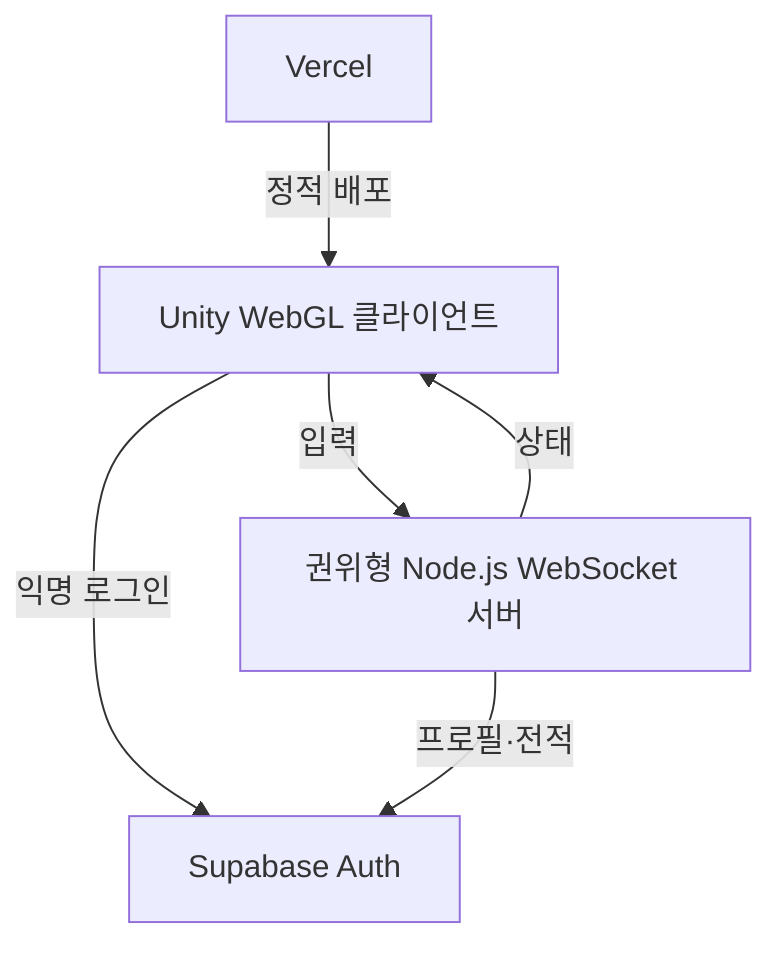

# Pop Pop Arena

귀여운 탐험대가 `팝 오브`를 설치해 길을 열고 상대를 버블에 가두는, **브라우저에서 플레이 가능한 독자 IP 4대4 대전 POC**입니다.

친구와 짧게 한두 판 즐기려는 초보·캐주얼 사용자를 위해, 한 판 2분·키보드/터치 조작·혼자 AI 연습 후 팀 대전 흐름을 제공합니다. 성별·연령별 선호는 아직 사용자 조사로 검증하지 않았습니다.

> 캐릭터와 맵은 독자 디자인입니다. 브라우저 맵은 테마별 SVG 이미지 타일을 사용하며, Unity 화면은 임시 도형을 사용합니다.

## 현재 구현 범위

| 영역 | 포함된 기능 |
| --- | --- |
| 로컬 전투 | 격자 이동, 파괴 블록, 오브 설치, 4방향 웨이브, 연쇄 점화, 아이템, 버블 탈락, 120초 경기 |
| 모바일 UX | 시작·결과 화면, 가상 방향키, `POP`·다트 버튼, 개인 점수·능력치 표시 |
| 온라인 대전 | 1대1 또는 4대4 룸, 캐릭터·스킨·맵 선택, 아이템전 ON/OFF, 클래식/팝 릴레이, 서버 권위 전투·구출·다트·승패, 초대 링크·동일방 재대결 |
| 계정·전적 | Supabase 익명 로그인, JWT 검증, 경기 점수판, 랭킹·등급·승무패, 서버 전용 결과 집계 |

## 구조



- **Unity 6 LTS:** 게임 화면, 터치/키보드 입력, 서버 상태 렌더링
- **Node.js + ws:** 룸과 전투 규칙을 소유하는 권위형 서버
- **Supabase:** 인증, 프로필, 랭크·전적 데이터
- **Vercel:** Unity WebGL 빌드와 소개·초대 페이지의 정적 배포

## 빠른 시작

### 브라우저 POC (Unity 설치 없이 실행)

Node.js 22 이상에서 다음 명령을 실행합니다.

```bash
cd Server
npm ci
npm run poc
```

브라우저에서 `http://localhost:8080`을 엽니다. **혼자 연습하기**를 누르면 로그인 없이 AI 7명과 4대4 연습전을 시작합니다. 연습전은 점수판만 표시하며 계정·랭킹에 기록하지 않습니다. 이동·물폭탄·아이템 안내를 따라 연습하고, 배경음악·효과음과 움직임 줄이기를 선택할 수 있습니다. 음악은 밝은 자체 8마디 멜로디이며 대기·대전·결과에 따라 템포/편곡이 바뀝니다. BGM과 효과음은 각각 기본 꺼짐이고, 음량 조절을 펼쳐 독립 음량을 바꿀 수 있습니다. [음악·효과음 구성](docs/Design/Audio-Guide.md)을 참고하세요.

친구와 대전하려면 캐릭터·스킨·맵과 `4 vs 4 · 8명`을 선택하고 같은 초대방 이름으로 8개 탭에서 입장하면 시작합니다. 인원이 모이기 전에는 대기합니다. 빠른 2인 확인에는 `1 vs 1 · 2명`을 선택합니다. 친구 초대 링크에는 방·인원·맵·아이템·승리 규칙이 함께 담기며 링크를 연 친구는 입장 버튼만 누르면 됩니다. 결과에서 남은 참가자가 모두 다시 준비하면 같은 방에서 다음 판을 시작합니다. 부족한 자리는 대기 중 새 참가자가 채울 수 있습니다. 방향키/WASD로 이동하고 Space로 물폭탄을 놓습니다. 모바일에서는 화면 방향 버튼과 POP 버튼을 사용합니다. 아이템전 ON/OFF를 선택할 수 있습니다. 버블 아군 옆으로 이동하면 구조되고, 다트를 습득하면 F 키 또는 모바일 다트 버튼으로 바라보는 방향에 발사합니다.

`npm run poc`는 로컬 개발 게스트 모드이며 인증·전적 저장은 사용하지 않습니다. 기본적으로 로컬 기기에서만 접속 가능합니다. LAN 테스트가 필요하면 서버 프로세스에 `HOST=0.0.0.0`을 명시하고 접근 가능한 서버 주소를 사용합니다. 공개 서비스의 사람 간 대전은 아래 Supabase 설정을 채우고 `ALLOW_DEV_GUESTS=false`로 `npm start`를 실행해야 합니다. HTTP와 WebSocket을 함께 제공하므로 HTTPS/WSS 종료가 가능한 서버에 배포합니다. 브라우저는 `/api/config`에서 URL과 공개 anon 키만 받으며 서비스 역할 키는 서버에만 있습니다.

[POC 완료 기준과 테스트 방법](docs/Design/POC-Acceptance.md)을 참고하세요. 기존 Unity 클라이언트도 동일한 서버를 사용하며 아래 방식으로 별도 빌드할 수 있습니다.

### 로컬 전투

1. Unity Hub에서 Unity 6 LTS 프로젝트로 이 폴더를 엽니다.
2. 빈 씬을 만들고 빈 GameObject에 `ArenaBootstrap`을 추가합니다.
3. Play를 실행합니다.

| 플레이어 | 이동 | 오브 설치 |
| --- | --- | --- |
| P1 | `W` `A` `S` `D` | `Space` |
| P2 | 방향키 | `Right Control` |

모바일/웹 터치에서는 시작 뒤 화면 하단의 방향 버튼과 `POP` 버튼을 사용합니다.

### 온라인 1대1 / 4대4

```bash
cd Server
npm ci
npm start
```

Unity의 `ArenaBootstrap` GameObject에 다음 컴포넌트를 추가합니다.

1. `WebGlSocketClient` — 서버 URL, 방 ID, 닉네임과 팀 모드 설정. 방 ID가 비어 있으면 맵별로 팀전은 `team-quick-<mapId>`, 1대1은 `quick-<mapId>`을 사용합니다.
2. `NetworkArenaRenderer` — 같은 `WebGlSocketClient`와 `ArenaGrid` 연결
3. `SupabaseAnonymousLogin` — Supabase 프로젝트 URL과 공개 anon 키, 같은 `WebGlSocketClient` 설정
4. `OnlineInputRouter` — 같은 `WebGlSocketClient` 연결 (`ArenaBootstrap`이 컴포넌트를 자동 추가)

WebGL 빌드를 실행하면 익명 로그인 후 선택 화면에서 캐릭터, 스킨과 맵을 고르고 온라인으로 입장할 수 있습니다. 첫 참가자가 정한 맵과 다른 맵을 선택한 참가자는 입장이 거부됩니다. 팀전은 8명이 모이면 시작합니다. 운영 환경에서는 `wss://` 주소를 사용합니다. 직접 개발용 게스트를 이용한다면 서버 환경에 `ALLOW_DEV_GUESTS=true`를 지정하고, 연결 전에 토큰 없이 `Connect()`를 호출해야 합니다. 공개 서버에서는 `false`로 둡니다.

## Supabase 설정

1. Supabase SQL Editor에서 [`Supabase/schema.sql`](Supabase/schema.sql)을 실행합니다.
2. [`Supabase/migrations/20261102_team_match_history.sql`](Supabase/migrations/20261102_team_match_history.sql), 이어서 [`Supabase/migrations/20261102_rankings.sql`](Supabase/migrations/20261102_rankings.sql)을 SQL Editor에서 적용합니다. 기존 데이터베이스에도 필요합니다. 경기별 참가자 점수와 승패·레이팅을 한 번만 집계하고 클라이언트의 랭킹 값 수정을 막습니다.
3. Authentication 설정에서 **Anonymous sign-ins**를 활성화합니다.
4. [`Server/.env.example`](Server/.env.example)을 참고해 WebSocket 서버의 프로세스 환경변수를 설정합니다. 서버는 `.env` 파일을 자동으로 읽지 않습니다.
5. Unity `SupabaseAnonymousLogin`에도 프로젝트 URL과 공개 anon 키를 설정합니다.

| 변수 | 위치 | 용도 |
| --- | --- | --- |
| `SUPABASE_URL` | 서버 | Supabase 프로젝트 URL |
| `SUPABASE_ANON_KEY` | 서버·Unity | 익명 로그인 및 JWT 검증용 공개 키 |
| `SUPABASE_SERVICE_ROLE_KEY` | 서버만 | 프로필·전적 기록 |
| `ALLOW_DEV_GUESTS` | 서버 | 로컬 개발용 우회. 공개 테스트/운영에서는 `false` |

`SUPABASE_SERVICE_ROLE_KEY`는 Unity WebGL, Vercel 정적 파일, 저장소에 절대 넣지 않습니다.

익명 세션은 브라우저 `sessionStorage`를 이용하므로 같은 탭에서만 재사용됩니다. 탭을 닫거나 저장소가 지워지면 기존 익명 계정과 전적을 다시 찾지 못할 수 있습니다. 장기적인 계정 보존을 위해서는 향후 계정 연결 기능이 필요하며 현재 구현되어 있지 않습니다. 인증된 사용자의 프로필 저장이 실패하면 서버는 `profile_unavailable` 오류를 반환하고 방 입장을 거부합니다.

## 주요 폴더

```text
Server/public/ 브라우저 POC 클라이언트
Assets/       Unity 게임·UI·WebGL 브리지 코드
Server/       권위형 WebSocket 게임 서버
Supabase/     데이터베이스 스키마
docs/         MVP 설계와 실시간 프로토콜
```

## 다음 작업

- 독자 IP 캐릭터·맵·이펙트·사운드 자산 적용
- 안전 구역 및 실제 8인 WebGL 경기 검증
- 자동 매칭, 재접속, 장기 계정 연결 및 운영 도구 추가
- WebGL 빌드 자동화와 Vercel/게임 서버 배포

## 검증과 현재 제한

```bash
cd Server
node --test test/*.test.js
cd ..
node --test Assets/Tests/*.test.cjs
# Python Playwright + Chromium 설치 환경
python3 scripts/browser-smoke.py
# 게스트 로그인 차단 상태에서 AI 연습·안내·접근성·재경기 검사
python3 scripts/practice-smoke.py
# 릴레이 운반·구출·득점, 초대 설정, 동일방 재대결
python3 scripts/relay-smoke.py
# 실제 Web Audio 재생 제어·원본 음악 WAV 렌더링 검사
python3 scripts/audio-smoke.py
```

비랭크 연습은 서버가 만든 고유 방에 사람 1명과 AI 7명을 넣습니다. AI는 일반 전투 규칙을 따르며 사람이 나가면 방 전체를 정리합니다. 동시 연습방은 프로세스당 8개이며 결과 화면을 2분 동안 방치하면 연결을 종료합니다. 인증 없는 연습은 정식 사람 대전·랭킹과 분리되어 있습니다.

아이템전에서는 파괴 블록에서 서버가 아이템을 드롭합니다. 기본전에서는 드롭과 아이템 사용이 없습니다. 기본전/아이템전은 다른 빠른 대전 방에 입장하며 초대방의 설정도 서버가 검증합니다.

| 아이템 | 효과 |
| --- | --- |
| 물폭탄+ (`orb`) | 동시 설치 수 +1, 최대 5 |
| 파동+ (`wave`) | 물폭탄 4방향 파동 길이 +1, 최대 7칸 |
| 운동화 (`dash`) | 한 칸 이동 간격 200ms → 100ms, 서버가 제한 |
| 핀 (`pin`) | 다음 피격 1회 방어, 중복 파동은 같은 틱에 중복 피격하지 않음 |
| 다트 (`dart`) | 최대 3발. 마지막 이동 방향으로 최대 7칸 발사. 벽/블록에 막힘. 첫 물폭탄을 점화하거나 아군 물감옥을 구출하고 적 물감옥을 터뜨려 탈락시킴 |

구출된 플레이어에게는 0.5초 보호시간이 있습니다. 경기 점수는 아이템 획득 10, 블록 파괴 5, 구출 50, 적 탈락 100, 승리 200점입니다. 경기 후 참가자 점수판을 표시합니다. `/api/leaderboard`에서 상위 50명과 등급·승무패를 읽습니다. 레이팅은 1,000부터 시작해 승리 +25, 패배 −15, 무승부 +5이며 0 아래로 내려가지 않습니다. Bronze <1,100 / Silver ≥1,100 / Gold ≥1,250 / Diamond ≥1,450입니다. 경기 점수와 레이팅은 별도입니다.

개발 게스트 모드는 서버 메모리의 임시 랭킹만 보여 주며 서버 재시작 시 초기화됩니다. 정식 모드는 Supabase 순위를 읽고, 설정/접속 실패 시 오류를 표시합니다. 임시 순위로 자동 대체하지 않습니다.

맵별 벽·파괴 블록은 `Server/public/assets/tiles/`의 독자 SVG 이미지 스킨을 사용합니다. 정원(울타리/나무상자), 라군(산호석/표류목), 캔디(웨이퍼/선물상자)로 구분합니다.

브라우저 캐릭터는 코드로 그린 독자 캐릭터이며 스킨·맵별 외형을 구분합니다. Unity 캐릭터는 임시 도형이며 모든 캐릭터의 능력치는 같습니다. 팀·1대1 방과 선택, 아이템 규칙은 서버 자동 테스트를 제공합니다. 브라우저 POC는 실제 Chromium 8세션에서 입장·키보드·물폭탄·구출·팀 결과를 검증합니다. Unity 편집기를 이용한 빌드와 실제 Supabase 전적 저장은 별도 환경에서 검증해야 합니다. 자동 매칭, 재접속, 장기 계정 연결과 관리 도구는 아직 없습니다. 브라우저에 경기 점수판과 랭킹 UI가 있으며 Unity 클라이언트의 새 다트·랭킹 UI는 별도 확장이 필요합니다.

## GitHub 자동화 및 배포

[역할별 GitHub 자동화 안내](docs/Operations/GitHub-Automation.md): CI는 푸시/PR에 자동 실행하며 개발·Code Review·Fix AI 역할과 컨테이너 게시 워크플로를 수동 실행할 수 있습니다. AI 역할에는 저장소 secret과 활성화 변수가 필요합니다. 실제 서버 배포 대상은 아직 지정하지 않았습니다.

랭킹 SQL을 로컬에서 검증하려면 Docker가 있는 Linux 환경에서 `python3 scripts/test-rankings-db.py`를 실행합니다. 인터넷 포트를 열지 않은 일회용 PostgreSQL을 사용하고 종료 시 정리합니다. 실제 Supabase에 연결하지 않습니다.

## 비교 평가와 다음 개선

[크레이지 아케이드 비교·점수표](docs/Design/Competitive-Assessment.md)에 완성도·재미·독창성·접근성·타깃 적합성의 고정 평가 기준과 5명 플레이 테스트 계획을 정리했습니다. 점수는 구현 상태를 보는 설계 평가이며 실제 재미 조사나 개발 완료율이 아닙니다.

## 팝 릴레이: 별을 우리 기지로

승리 규칙에서 **팝 릴레이**를 선택하면 중앙 별을 획득해 자기 팀 B/P 기지로 전달하는 4대4를 즐길 수 있습니다. 3회 전달하면 승리하며, 2분 종료 시 더 많이 전달한 팀이 이깁니다. 동점은 무승부입니다.

- 버블에 갇히거나 탈락하면 별을 떨어뜨립니다. 아군을 구출하고 운반자를 호위하거나 상대 운반자를 물폭탄으로 막을 수 있습니다.
- 별을 전달하면 팀1점과 개인150점을 얻고, 별은5초 후 중앙에 다시 나타납니다.
- 탈락하면5초 뒤 자신의 출발 위치로 복귀하고1초 보호를 받습니다. 위험한 폭탄/파동이 남아 있으면 안전해질 때까지 복귀가 늦어집니다.
- 릴레이는 AI 연습과 사람 대전에서 모두 선택 가능하며 **비랭크**입니다. 사람 대전 인증은 유지하지만 릴레이 결과·레이팅을 저장하지 않습니다.

클래식은 기존 생존전과 랭킹 집계를 유지합니다. 이번 초대·릴레이·재대결 UI는 브라우저에 적용했으며 Unity 신규 UI는 별도 확장이 필요합니다.

[벤치마크02 결과](docs/Design/Benchmark-02-Relay-Social.md)에 같은 기준의 전후 점수와 검증 근거를 기록했습니다.
