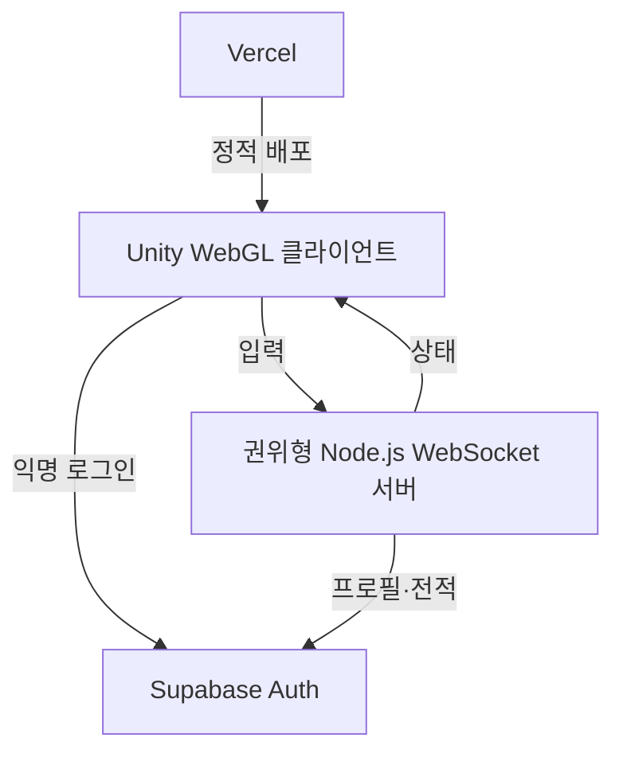

# Pop Pop Arena

귀여운 탐험대가 `팝 오브`를 설치해 길을 열고 상대를 버블에 가두는, **Unity WebGL 기반의 독자 IP 캐주얼 1:1 대전 MVP**입니다.

10~20대와 어린이·여성 사용자가 짧은 시간에 부담 없이 즐길 수 있도록, 한 판 2분·간단한 터치 조작·즉시 재도전 흐름을 목표로 합니다.

> 이 프로젝트는 특정 기존 게임의 명칭, 캐릭터, 맵, 그래픽, 사운드, UI 또는 기타 자산을 사용하지 않습니다. 현재의 모든 시각 요소는 게임 규칙 검증을 위한 임시 도형입니다.

## 현재 구현 범위

| 영역 | 포함된 기능 |
| --- | --- |
| 로컬 전투 | 격자 이동, 파괴 블록, 오브 설치, 4방향 웨이브, 연쇄 점화, 아이템, 버블 탈락, 120초 경기 |
| 모바일 UX | 시작·결과 화면, 화면 하단 가상 방향키, `POP` 설치 버튼 |
| 온라인 1:1 | 2인 룸, 서버 권위 이동·오브·웨이브·버블·승패 판정, WebGL WebSocket 브리지 |
| 계정·전적 | Supabase 익명 로그인, JWT 검증, 프로필·경기 결과 스키마 및 서버 전용 저장 경계 |

## 구조



- **Unity 6 LTS:** 게임 화면, 터치/키보드 입력, 서버 상태 렌더링
- **Node.js + ws:** 룸과 전투 규칙을 소유하는 권위형 서버
- **Supabase:** 인증, 프로필, 랭크·전적 데이터
- **Vercel:** Unity WebGL 빌드와 소개·초대 페이지의 정적 배포

## 빠른 시작

### 로컬 전투

1. Unity Hub에서 Unity 6 LTS 프로젝트로 이 폴더를 엽니다.
2. 빈 씬을 만들고 빈 GameObject에 `ArenaBootstrap`을 추가합니다.
3. Play를 실행합니다.

| 플레이어 | 이동 | 오브 설치 |
| --- | --- | --- |
| P1 | `W` `A` `S` `D` | `Space` |
| P2 | 방향키 | `Right Control` |

모바일/웹 터치에서는 시작 뒤 화면 하단의 방향 버튼과 `POP` 버튼을 사용합니다.

### 온라인 1:1

```bash
cd Server
npm install
npm start
```

Unity의 `ArenaBootstrap` GameObject에 다음 컴포넌트를 추가합니다.

1. `WebGlSocketClient` — 서버 URL, 방 ID, 닉네임 설정
2. `NetworkArenaRenderer` — 같은 `WebGlSocketClient`와 `ArenaGrid` 연결
3. `OnlineInputRouter` — 같은 `WebGlSocketClient` 연결

WebGL 빌드에서 `WebGlSocketClient.Connect()`를 호출합니다. 운영 환경에서는 반드시 `wss://` 주소를 사용합니다.

## Supabase 설정

1. Supabase SQL Editor에서 [`Supabase/schema.sql`](Supabase/schema.sql)을 실행합니다.
2. Authentication 설정에서 **Anonymous sign-ins**를 활성화합니다.
3. [`Server/.env.example`](Server/.env.example)을 참고해 WebSocket 서버 환경변수를 설정합니다.

| 변수 | 위치 | 용도 |
| --- | --- | --- |
| `SUPABASE_URL` | 서버 | Supabase 프로젝트 URL |
| `SUPABASE_ANON_KEY` | 서버·Unity | 익명 로그인 및 JWT 검증용 공개 키 |
| `SUPABASE_SERVICE_ROLE_KEY` | 서버만 | 프로필·전적 기록 |
| `ALLOW_DEV_GUESTS` | 서버 | 로컬 개발용 우회. 공개 테스트/운영에서는 `false` |

`SUPABASE_SERVICE_ROLE_KEY`는 Unity WebGL, Vercel 정적 파일, 저장소에 절대 넣지 않습니다.

## 주요 폴더

```text
Assets/       Unity 게임·UI·WebGL 브리지 코드
Server/       권위형 WebSocket 게임 서버
Supabase/     데이터베이스 스키마
docs/         MVP 설계와 실시간 프로토콜
```

## 다음 작업

- 독자 IP 캐릭터·맵·이펙트·사운드 자산 적용
- 서버 권위형 아이템 드롭·구조·안전 구역 규칙 완성
- 매칭, 랭킹, 전적 화면 및 운영 도구 추가
- WebGL 빌드 자동화와 Vercel/게임 서버 배포
