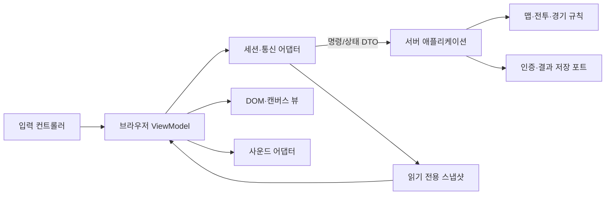

# 객체지향·MVVM 구조 검토

검토 기준: `b4fb258`, 2026-11-06. 브라우저·Node 서버·Unity 코드를 함께 확인했다. 기준 커밋은 **Unity 컴포넌트와 JavaScript 함수/모듈을 혼합한 구조**이며 엄격한 MVVM이나 도메인 객체지향 구조로 부르기는 어렵다. 아래 첫 표는 변경 전 평가이고, 실제 개선 결과는 마지막 절에 구분했다.

| 항목 | 현재 판정 | 근거 |
| --- | --- | --- |
| 캡슐화·정보 은닉 | 부분 적용 | Unity `GridPlayerController`의 private 필드/읽기 전용 getter, 브라우저 preferences/audio와 서버 result-outbox의 클로저는 상태를 숨긴다. Room/Player는 공개 변경 가능 객체를 여러 모듈이 공유한다. |
| 인터페이스·다형성 | 경계 일부만 구현 | Outbox의 persist/clock/filesystem 주입은 교체 가능한 계약이다. 사용자 C#에는 interface/abstract/virtual/override 선언이 없으며 11개 컴포넌트가 sealed MonoBehaviour다. 프레임워크 상속과 도메인 다형성은 구분해야 한다. |
| 상속·가상 메서드 | 도메인 계층 없음 | 클래스 수나 상속 깊이는 품질 점수가 아니다. 동일 능력치의 스킨은 상속보다 데이터+렌더링 전략, 경기 규칙은 공통 계약에 대한 합성이 적합하다. |
| 모듈 의존성 | 순환 import 없음, 방향 개선 필요 | 서버의 정적 import는 비순환이다. 다만 relay가 bots의 위험 예측에 의존하고, index가 인증·방·전투·저장을 조정하면서 직접 구현한다. |
| MVVM | 미적용 | 브라우저 app.js의 소켓 수신→공유 상태→DOM, 입력, 캔버스 그리기가 한 파일에 있다. result-saving의 순수 표시 모델은 ViewModel의 기반이다. |
| UI/규칙 분리 | 부분 적용 | Unity ArenaGrid는 충돌 데이터와 GameObject를, GridPlayerController는 입력·규칙·표현을, MatchDirector는 경기와 OnGUI를 함께 소유한다. MobileHud도 인증·선택·게임 서비스를 직접 조정한다. |
| 캐릭터·맵·오브젝트·소리 | 기능 단위 분리, 표현 중복 | 서버에 catalog/pickups/combat가 있고 Unity에는 해당 컴포넌트가 있다. 브라우저는 캐릭터·맵·폭탄·아이템을 app.js에서 그린다. audio.js는 별도 모듈이며 Unity AudioSource/AudioClip 구현은 없다. |
| 상태·DTO 경계 | 전송 허용 목록은 양호 | 서버의 공개 state와 저장 DTO는 허용 필드만 내보낸다. Unity LatestState는 public mutable DTO를 UI에 그대로 전달하므로 읽기 전용 표시 모델과 구분할 필요가 있다. |
| IPC | 게임용 OS IPC 없음 | WebSocket은 브라우저/Unity↔서버 네트워크 프로토콜, DllImport↔jslib SendMessage는 WebGL 언어 브리지, StateReceived는 프로세스 내부 이벤트다. 테스트 자식 프로세스 IPC를 게임 IPC로 평가하지 않는다. |

## 확인된 위험과 개선 순서

1. 브라우저 렌더링 루프가 입력 재전송도 수행한다. 해상도/프레임 설정 변경이 입력에 영향을 주지 않도록 물리 키 입력 컨트롤러와 캔버스 뷰를 분리한다.
2. 서버·브라우저·Unity가 벽 구조를 각자 계산한다. 브라우저와 서버는 공유 맵 카탈로그/공개 solid를 사용하고 Unity 후속 구현은 같은 DTO를 소비하도록 한다.
3. 랭크 자격 검사가 index/rankings/outbox에 중복되어 Outbox 자체는 친구+AI를 거부하지 않는다. 현재 네트워크 경로는 앞단에서 차단하지만, 저장소 계약도 단일 정책을 사용해야 한다.
4. 인증·프로필 fetch에는 결과 저장과 달리 시간 제한이 없다. 어댑터에 주입 가능한 fetch와 제한 시간을 두고 지연·오류를 비밀 정보 없는 오류로 변환한다.
5. 위험 예측을 AI 모듈에서 중립 grid/hazards 모듈로 옮긴다. Classic/Relay/Harmony/Training은 같은 규칙 계약을 따르고, 전송 계층이 내부 전투 상태를 대신 변경하지 않도록 경계를 줄인다.

이는 목표 구조다. 구현 여부는 실제 모듈과 의존성 검사로 따로 기록하며, 다이어그램만으로 MVVM 완료를 주장하지 않는다. 서버에는 MVVM 대신 전송→애플리케이션→도메인→저장소 경계를 적용한다. 모든 함수를 클래스로 바꾸거나 객체마다 OS 프로세스를 만들 필요는 없다.

Unity 후속 방향은 `IGameSession`의 로컬/온라인 구현, 순수 C# 게임 모델, 화면 표시용 ViewModel과 씬 컴포넌트다. 이번 환경에는 Unity 편집기/컴파일러가 없어 C# 구조 변경·WebGL 빌드의 정상 동작을 주장하지 않는다. 읽기 전용 확인에서 JS 브리지·오디오·조작·설정·결과 표시 30개 검사는 통과했으며, C# EditMode/PlayMode 테스트는 발견하지 못했다.

## 이번 구현 이후 판정

**객체지향 원칙과 MVVM을 부분 적용했다. 전체 프로젝트가 엄격한 MVVM이나 완전히 캡슐화된 도메인 모델로 전환된 것은 아니다.** JavaScript의 팩토리·클로저·객체 합성으로 경계를 만들었으며, 클래스나 상속의 수를 늘리는 방식은 사용하지 않았다.

| 요청 항목 | 실제 구현 | 남은 한계 |
| --- | --- | --- |
| 캡슐화·정보 은닉 | `arena-viewmodel.js`는 입력 스냅샷을 복제·깊은 동결하고 내부 상태를 클로저에 보관한다. 명령 가능 여부를 검사하며 외부에는 읽기 전용 상태와 명령 API를 제공한다. 입력·설정·오디오·소켓도 팩토리 내부 상태를 사용한다. | 서버 Room/Player는 공개 변경 가능한 객체이며 index/engine/combat/rules가 함께 변경한다. |
| 인터페이스·다형성 | `rules.js`의 `initialize/step/result/snapshot` 공통 계약으로 classic/relay/training/harmonyTraining의4개 전략을 호출한다. 일반 Harmony 경기는 relay 전략과 내부 규칙 분기를 공유하며 하모니 훈련만 별도 전략이다. ViewModel의 send, 인증의 fetch, Outbox의 persist/clock/filesystem을 교체·검사할 수 있다. | JSDoc과 테스트 기반의 구조 계약이다. TypeScript/C# 정적 interface 강제나 별도 Harmony 클래스는 없다. |
| 상속·가상 메서드 | 동적 메서드 호출과 합성으로 규칙을 교체한다. 외형은 순수 카탈로그와 공통 렌더 함수로 조합한다. | 사용자 도메인 상속 계층, abstract/virtual/override는 도입하지 않았다. Unity의 MonoBehaviour 상속은 그대로다. |
| MVVM | `arena-viewmodel.js`의 `projectArena`가 표시 상태와 명령 가능 여부를 만든다. app이 상태를 전달하고 DOM/뷰를 연결하며, VM은 DOM/WebSocket/Canvas/AudioContext를 생성하지 않는다. | app.js에 HUD·결과·복귀·DOM 조정이 남는다. 전체 표시 모델을 VM으로 옮긴 엄격한 MVVM은 아니다. Unity UI에는 아직 적용하지 않았다. |
| 캐릭터·맵·오브젝트·사운드 | `cosmetics/visuals`는 외형·캐릭터·오브·아이템 표현, `map-catalog`는 서버/브라우저 공통 배치, `arena-renderer`는 경기 뷰, `audio`는 소리, `input-controller`는 물리 키, `display`는 해상도를 담당한다. | 캐릭터·맵마다 독립 클래스나 OS 프로세스가 있는 구조는 아니다. Unity의 기존 데이터/씬 결합도 남는다. |
| 비즈니스 로직·의존성 | `match-engine`이 입력 처리·폭발·틱을 소유하고 `rules`가 경기 수명을 조정한다. `hazards`를 중립 모듈로 옮겨 relay→bots 의존을 제거했다. `ranked-policy`를 저장·랭킹·서버가 공통 사용한다. | engine의 연결 판정은 여전히 `player.socket.readyState`를 읽는다. 네트워크와 완전히 독립된 도메인 엔진은 아니다. |
| IPC·통신 | `socket-transport`가 브라우저 WebSocket 수명과 전송을 담당하고, VM에는 send 포트를 주입한다. 외부 상태는 JSON DTO로 전달한다. | WebSocket은 네트워크 통신이다. Actor/Worker/OS IPC는 없으며, 기존 WebGL 언어 브리지와 프로세스 내부 이벤트도 별개다. |

독립 코드 리뷰에서 기초 경계72개와 통합 규칙·VM·복귀83개 검사, 최종 훈련·인증·표시 경계81개 검사가 통과했다. 최종 public/src의 상대 import35개 모듈·67개 연결에서 순환이나 누락은 발견되지 않았다. 이는 상태 소유권과 런타임 결합까지 모두 없다는 증거는 아니다. 새 기능의 최종 실행 결과는 [벤치마크06](../Design/Benchmark-06-Experience.md)에 기록한다.

다음 구조 개선은 `PlayerSession`의 연결 상태와 순수 `PlayerState`를 분리하고, 엔진에 연결 여부/시간을 주입하는 것이다. 이어서 app의 HUD·결과·복귀 표시 모델을 VM으로 이동하고, Unity 빌드 환경에서 `IGameSession`·ViewModel·씬 어댑터를 실제 컴파일·PlayMode 검사로 검증한다. 클래스 전면 변환보다 이 의존성 제거가 우선이다.

## 등급 매칭·파티·동시성 증분의 구조

`matchmaking.js`는 후보 선택과35개 팀 분할을 다루는 순수 도메인 모듈이다. `queue-sessions.js`는 인증·claim·방 배정 포트를 주입받아 비동기 수명을 조정하고, `index.js`가 실제 방/소켓과 조립한다. `series.js`는 라운드/목표/기여/종합 점수를 소유하고 복사한 허용 목록 DTO를 제공한다. 클라이언트의 `matchmaking-viewmodel.js`는 요청 ID와 취소/배정 상태를 캡슐화하며, 기존 Arena VM은 현재 경기·파티·명령 가능 여부를 투영한다.

`runtime.js`와 `async-gate.js`는 경기 규칙 대신 접속/입출력 제한과 비동기 동시성을 담당한다. 함수·클로저·객체 계약을 합성한 구조이며 TypeScript interface나 상속/가상 메서드 계층을 새로 만들지는 않았다. 이런 분리는 테스트와 책임 경계를 개선하지만 `index.js`/`app.js`의 세션 조정과 공유 가변 Room/Player는 남아 있으므로 완전한 도메인 캡슐화 또는 엄격한 MVVM으로 판정하지 않는다.

이번 실제 IPC는 Node와 Linux `flock` 자식 사이의 stdin 수명 pipe/준비 handshake다. 게임 서버 간 공유 메모리·Worker 스레드 IPC를 도입한 것은 아니다. 네트워크 클라이언트는 여전히 JSON/WebSocket을 사용하고 결과 저장은 파일/HTTP/DB 경계로 분리한다. 보장과 한계는 [동시성·스레드·잠금 검토](Concurrency-Review-2026-11-06.md)를 따른다. Unity 소스의 기존 결합과 빌드 미검증 상태는 바뀌지 않았다.

## 브라우저 전투 모션의 표현 경계

`motion-timeline.js`는 공개 스냅샷에서 선수 포즈와 제한 시간의 표현 사건을 만든다. 내부 이력은 클로저에 숨기고 입력과 반환 데이터를 복사한다. DOM·Canvas·네트워크·독립 타이머를 생성하지 않으며 서버 판정이나 ViewModel 상태를 쓰지 않는다. 시간과 연결·숨김·효과 설정은 호출자가 전달한다. 선수8명·사건128개와 경기 크기별 타일 채널(13×11은143칸, 15×13은195칸)로 이력 크기를 제한한다. 맵 크기가 바뀌면 이전 표현 이력을 초기화한다.

`arena-renderer.js`가 타임라인과 화면 좌표를 조립하고, `visuals.js`는 캐릭터·오브·아이템의 몸체를, `arena-effects.js`는 사건 장식을 그린다. 필수 위험 칸은 스냅샷으로 즉시 표시하며 표현 보간으로 판정을 지연하지 않는다. 연결·페이지 수명에 따른 초기화도 렌더러에 연결했다. 새 클래스 상속이나 게임 계산용 스레드를 도입한 것은 아니며, 함수와 주입 가능한 계약으로 표현 책임을 분리한 변경이다.
