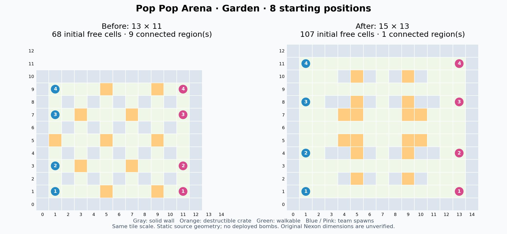
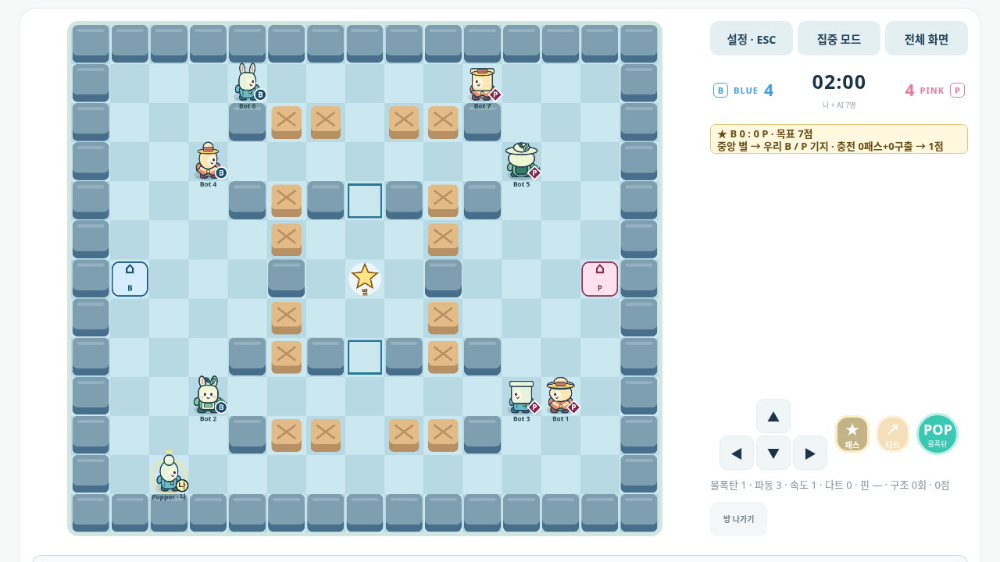

# 8인 팀전 공간 확장

일반 4대4의 다섯 맵을 외곽 포함 **15×13칸**으로 확장했다. 내부는99칸에서143칸으로 **44.4% 증가**했다. 두 팀의 출발점과 장애물 배치를 좌우·상하 대칭으로 만들고, 각 출발점에 두 개 이상의 즉시 이동 경로를 확보했다. 1대1과 기본·하모니 단계별 훈련은 기존13×11칸을 유지한다.

크기만 늘리는 대신 가든의 분리된 시작 구역을 연결했다. 아래 값은 실제 서버 배치와 수문 상태에서 계산한 정적 이동 공간이다. 설치된 물폭탄이나 사람의 의사결정을 포함한 승률 측정은 아니다.

| 맵 | 기존 시작 이동 가능 칸 | 변경 후 | 변경 후 연결 구역 | 각 팀 진영 내 이동 가능 칸 |
| --- | ---: | ---: | ---: | ---: |
| 팝 가든 | 68 | 107 | 1 | 48 / 48 |
| 반짝 라군 | 68 | 107 | 1 | 48 / 48 |
| 캔디 타운 | 69 | 107 | 1 | 48 / 48 |
| 썰물 부두, A 닫힘 | 77 | 113 | 1 | 48 / 48 |
| 썰물 부두, B 닫힘 | 77 | 113 | 1 | 52 / 52 |
| 풍선 광장 | 79 | 119 | 1 | 54 / 54 |

가든은 시작 시9개 구역이던 공간이 하나로 연결된다. 기존 blue 출발점은 각9칸 구역을 두 명씩 공유했고 pink는22칸 구역을 네 명이 공유했다. 새 가든은 양 팀 모두 자기 진영 안에서48칸을 이동할 수 있다. 다른 팀의 공간과 중앙 열을 빌리지 않고 계산한 값이다.

모든 새 배치에서 각 출발점의 세 걸음 이내 이동 가능 칸은10칸 이상이다. 초기·상자 제거 후 모두 막다른 칸이 없고, 이동 가능 칸 하나를 막아도 전체 경로가 분리되지 않는다. 기본 사거리 물폭탄을 자기 자리에서 놓았을 때 두 걸음으로 파동 십자에서 벗어날 수 있다. 여러 물폭탄과 실제 상대의 공격까지 안전하다는 뜻은 아니다.

큰 맵의 출발점은 x1/x13, y1·4·8·11이다. 위·아래 우회로 y3/y9와 중앙 y6 경로를 두며, 부두의 중앙 경로는 수문 상태에 영향을 받는다. 릴레이·하모니 중앙과 기지도 새 크기에 맞춘다. 서버 이동·폭발·다트·위험 예측·AI 경로·패스와 브라우저 안내가 같은 좌표 모듈을 사용한다. 물폭탄2초, 버블2초와 이동 속도는 바꾸지 않았다.

큰 맵은 상자를 먼저 깨지 않아도 상대 진영에 접근할 수 있다. 상자는 아이템 공급과 엄폐·중앙 공간 확보 역할이 커진다. 열린 공간이 많아 파동이 길게 이어질 수도 있으므로, 확대와 대칭만으로 재미나 승률 균형을 단정하지 않는다. 실제 사람의8인 플레이테스트는 후속 검증 항목이다.

브라우저는 큰 맵900×780, 작은 맵780×660 논리 화면을 사용한다. 화면 배율·해상도·미리보기·세로/가로 배치와 전투 모션 이력도 경기 크기를 따른다. Unity 소스에는 서버 arena/solid를 소비하는 동적 지형·바닥·카메라 처리를 추가했으나, Unity 편집기·컴파일러가 없어 실제 WebGL 빌드는 검증하지 않았다.

원작 넥슨 크레이지 아케이드의 정확한 격자 수는 이번 환경에서 확인하지 못했다. **15×13은 이 POC의 개선 설계값**이며 원작과 같은 크기라는 주장이 아니다. 이전 벤치마킹 점수를 새 점수로 올려 기재하지 않는다.

데스크톱 터치 환경의 집중·전체화면은 보드와 상태·조작 영역을 나란히 배치한다.

화면 회전 후 브라우저가 남긴 스크롤로 파티 달성 알림이 잘리면, 보드와 조작 버튼이 함께 들어오는 범위에서 위치를 보정한다. 열린 설정창·전체화면·종료 화면이나 이미 화면 밖으로 넘긴 알림에는 적용하지 않는다.

## 실행 검증

최종 소스에서 Node 검사 **614/614**, 브라우저 검증 명령 **13/13**이 통과했다. 자동화가 실제 브라우저 입력과 공개 서버 상태를 사용했으며 사람 플레이테스터는0명이다. [검증 명령·로그·소스 해시](evidence/arena8/browser-verification.json), [최종 8인 실행 기록](evidence/arena8/arena8-report.json), [맵 공간 원시 계산](evidence/arena8/metrics.json)을 함께 보관한다.

| 범위 | 확인한 내용 |
| --- | --- |
| 8개 브라우저 | 4대4 배정, x13/y11 이동, 기존 경계를 넘는 실제 물결·다트 구출·별 패스, 동일방 재경기와 빈자리 충원 |
| 기존 모드 | 클래식·릴레이·하모니·3라운드 파티, 등급 매칭·재접속·재경기, 7AI 실제 한 판·재시작 |
| 작은 맵 보존 | 1대1, 기본/하모니 실제 훈련·실패·재시도, 13×11→15×13 연습→13×11 훈련 전환 |
| 화면 | 360×640, 390×844, 844×390, 1280×720, 1920×1080; DPR1/2·글자130%; 실제 전체화면5건, 대체 화면0건 |
| 조작·표식 | 보드와7개 조작 버튼의 화면 내 배치, 버튼44 CSS px 이상, 핵심 표식10 CSS px 이상; 파티 목표 알림의 세로→가로 회전 검사 |
| 전투 모션 | 전체·편안하게·최소 효과의 실제 연쇄 폭발, 아직 퓨즈가 남은 후속 물폭탄 점화, 구출·탈락·복귀·패스·캐릭터 추적 표식; 1인+7AI 영상 |

아이템·다트 시나리오는 기존 결정적 드롭 RNG fixture를 사용한다. 게임 상태나 시간을 주입하지 않았고, 물폭탄·버블 제한시간을 늘리지 않았다. 등급·저장 검증은 엄격한 로컬 Supabase HTTP fixture이며 실제 공개 Supabase 배포 검증이 아니다. 기존 Unity JavaScript 브리지5개 검사도 통과했으나 C# 컴파일·Unity 실행의 증거는 아니다.

[실제 8개 클라이언트 대전 화면](evidence/arena8/eight-client-game.png) · [세로 화면](evidence/arena8/mobile-portrait.png) · [파티 가로 화면](evidence/arena8/party-landscape.png) · [파티 조작 영역 측정](evidence/arena8/party-control-bounds.json)

최종 Docker 이미지에서58개 실행 소스 파일의 해시가 작업 소스와 일치했다. UID1000·운영 게스트 거부·15×13 부두의1인+7AI 시작·정상 종료를 확인했다. [이미지와 소스 검증](evidence/arena8/docker.json)에 식별자를 기록했다.

별도 localhost 부하에서는64접속·8개 방을60초 실행해 입력19,200회와 ping3,840회를 처리했고 입력 배치 누락은0이었다. RTT p95는3.68ms, 표본 틱 계산 p95는3.04ms, 틱 지연 p95는0.95ms였다. 종료 후 접속·방·매칭 큐·인증 작업이0으로 정리됐다. 이는 같은 호스트의 자동 접속 측정이며 실제 인터넷·인증 DB·장기 운영 수용량을 보장하지 않는다. [부하 원시 결과](evidence/arena8/load.json) · [최종 검증 요약](evidence/arena8/verification.json)
