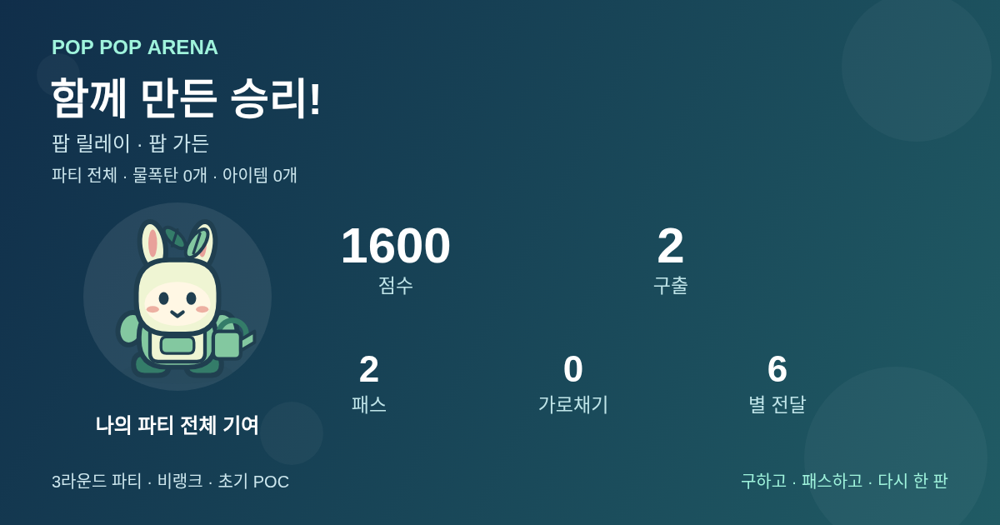
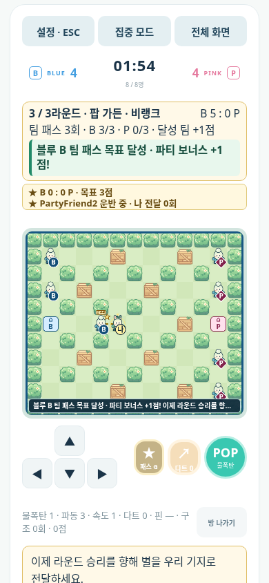

# 벤치마크 07: 등급으로 만나고, 같은 팀으로 세 판을 잇기

평가일: 2026-11-06. 출발점은 `c41ce044`의 [벤치마크 06](Benchmark-06-Experience.md) **80/100**이다. 평가 대상은 이 커밋 위의 매칭·파티·운영 보호·팀 Elo 변경분이며, 검증 당시 작업 트리는 아직 커밋 전이었다. 구현에 참여하지 않은 AI 평가자가 고정 기준, 소스, 실제 실행 로그와 Chromium 이미지를 읽었다. 운영·견고함·반복 변주 세 기준은 별도 읽기 전용 평가자의 견해도 확인했으며 최종 판단은 이 문서의 평가자가 내렸다.

**최종 독립 설계 평가: 84.625/100. 이전보다 +4.625점이며, 목표 85에는 0.375점 미달한다. 반올림으로 목표를 충족 처리하지 않는다.** 최종 검증에서 확인한 미해결 코드 차단 문제는 없지만, 이는 모든 운영·경험 공백이 해소됐다는 뜻이 아니다. 기능 수·테스트 수·목표 숫자를 점수로 환산하지 않았다.

점수는 AI 평가자의 휴리스틱 설계 판단이다. 실제 사용자 참가자는 **0명**이며, 자동 브라우저의 참가자 슬롯과 실제 사람을 구분한다. 주관적 재미·인기도·잔존율·인간 대전 밸런스·공개 서비스 준비율의 실측값이 아니다. Unity C# 빌드, 실제 Supabase 프로젝트와 공개 HTTPS/WSS 배포도 미검증이다.

## 고정 기준과 정확한 계산

[최초 비교 평가](Competitive-Assessment.md)의 다섯 항목, 비중, 20개 하위 기준과 0~10 척도를 유지한다. 각 항목은 네 하위 점수의 단순 평균이다. 척도는 0 부재, 2 큰 진입·사용 장애, 5 기본 경험과 큰 공백, 8 대체로 일관되고 충분한 경험, 10 해당 목적에서 뚜렷한 공백이 없는 상태다. 소수점은 계산 재현을 위한 것이며 실측 정밀도를 뜻하지 않는다.

| 항목 | 비중 | 하위 기준 순서 | 출발 하위 점수 | 최종 하위 점수 | 최종 평균 | 가중 기여 /10 |
| --- | ---: | --- | --- | --- | ---: | ---: |
| 완성도 | 25% | 핵심 경기의 끝까지 연결 / 콘텐츠와 사용자 흐름 / 오류·상태 경계의 견고함 / 실제 서비스 준비 | 8 / 9 / 8 / 4 | 9 / 9.5 / 9 / 5.5 | 8.25 | 2.0625 |
| 재미 | 25% | 설치·회피·연쇄의 순간 판단 / 팀 협력과 구조 / 전략·반복 플레이 변주 / 행동 결과의 피드백 | 8.5 / 8.5 / 8.5 / 8.5 | 8.5 / 9 / 9 / 9.5 | 9 | 2.25 |
| 독창성 | 20% | 독자 시각·캐릭터 정체성 / 규칙의 차별성 / 기억할 수 있는 제품 약속 / 이용 방식의 차별성 | 8 / 8 / 8 / 6 | 8 / 8 / 8.5 / 6 | 7.625 | 1.525 |
| 접근성 | 20% | 처음 경기 시작·학습 / 입력 수단 / 정보 가독성·색 외 단서 / 움직임·소리 조절 | 9 / 8.5 / 9 / 8 | 9.5 / 8.5 / 9 / 8 | 8.75 | 1.75 |
| 타깃 적합성 | 10% | 짧은 세션 / 친구와 함께하기 / 초보자가 연습·실패 후 다시 하기 / 웹·모바일 사용 맥락 | 8 / 8 / 9 / 8.5 | 8.5 / 8.5 / 9.5 / 8.5 | 8.75 | 0.875 |

`8.25×0.25 + 9×0.25 + 7.625×0.20 + 8.75×0.20 + 8.75×0.10 = 8.4625`이다. 100점 환산은 **84.625**, 유리수로는 `677/8`이다. 출발점과의 차이는 `37/8 = 4.625`, 목표와의 차이는 `3/8 = 0.375`다. 가중치 변경·정규화·올림은 없다.

검토 중 기록한 잠정값은 **83.3125 → 84 → 84.3125**였다. 첫 판단에서는 파티 개인 기록이 마지막 판에 한정되고 훈련 설명 중 전체 제한시간이 흘렀다. 다음 판단은 파티 전체 기록과 훈련 활동 시간 분리를 반영했다. 세 번째 판단은 목표 달성 피드백의 종료 후 문구와 실제 모바일 조작 영역을 확인했다. 최종 84.625는 여기에 공식 로컬 부하·배포 산출물 검증으로 확인한 운영 준비 근거를 제한적으로 더한 값이다. 당시 공백과 현재 상태를 혼동하지 않는다.

## 20개 하위 기준의 개별 판단

| 항목·하위 기준 | 출발 → 최종 | 확인한 변화와 제한 |
| --- | ---: | --- |
| 완성도 · 핵심 경기의 끝까지 연결 | 8 → 9 | 서버 프로필 조회→8인 배정→경기→결과→같은 참가자 재경기/다음 상대가 연결된다. 프로필 실패·취소 때 기존 결과를 유지하고, Elo 적용 후 저장 값을 다음 검색에서 읽는다. 원래 8명이 부족하면 재경기를 막는다. 파티의 세 판 종료와 새 파티 합의도 확인했다. 실제 공개 서비스 계정의 전 과정은 미검증이다. |
| 완성도 · 콘텐츠와 사용자 흐름 | 9 → 9.5 | 기존 단판·훈련·친구+AI에 선택형 파티가 연결되며, 세 판의 내 기여가 라운드 이력→전체 합계→개인 PNG까지 이어진다. 기존 맵 수를 새 콘텐츠 수로 다시 세지 않는다. 장기 진행·콘텐츠 깊이와 많은 로비 선택지는 남는다. |
| 완성도 · 오류·상태 경계의 견고함 | 8 → 9 | 인증 gate·취소 세대·계정 claim·동기 배정·정원·느린 송신·입력 폭주·준비 멱등성·결과 접수 예약을 실제 경계 검사로 확인했다. OS 작성자 잠금과 PostgreSQL 행 잠금·동일 경기 재전송의 한 번 집계도 확인했다. 진행 경기·큐·파티의 프로세스 장애 후 복원, 다중 서버 일관성, 장기 장애 조합은 미해결이다. |
| 완성도 · 실제 서비스 준비 | 4 → 5.5 | 기존 Docker·SQL의 존재에 더해 실제 이미지와 검증 소스의 일치, 공유 볼륨 작성자 제한, 수용 상한·진단·종료 절차, 조건을 공개한 60초 처리 예산을 확인했다. 운영자가 사용할 수 있는 준비 근거가 늘었다. 실제 Supabase·공개 TLS·백업 복구·운영 알림·인터넷 부하는 없으므로 성숙한 서비스 수준으로 올리지 않는다. |
| 재미 · 설치·회피·연쇄의 순간 판단 | 8.5 → 8.5 | 기존 수문·연쇄·패스·가로채기·예상 경로의 선택을 유지한다. 매칭과 레이팅 계산을 새 전투 조작이나 순간 판단으로 중복 가산하지 않는다. 인간 대전의 페이스는 미측정이다. |
| 재미 · 팀 협력과 구조 | 8.5 → 9 | 실제 구출·아이템·패스 목표가 팀당 보너스 1점과 파티 승패에 연결된다. 자동 브라우저에서 구출 2회와 성공한 패스 3회의 보너스를 확인했다. 같은 두 명의 반복 패스·같은 대상 구출도 세므로 목표 악용·역할 균형은 인간 대전에서 검증해야 한다. |
| 재미 · 전략·반복 플레이 변주 | 8.5 → 9 | 세 맵의 연속 라운드와 승리/무승부/협동 목표의 누적 점수가 다음 판의 목적을 만든다. 마지막 판 승자와 전체 승자가 달라질 수 있다. 기존 맵의 자동 순환만을 새 전략으로 세지 않으며, 일반적인 Elo·큐 자체를 전략 콘텐츠로 추가 가산하지 않는다. 고정 목표의 숙련 후 반복 가치는 미측정이다. |
| 재미 · 행동 결과의 피드백 | 8.5 → 9.5 | 목표 달성을 한 번 알리고 현재 단계에 맞는 다음 행동을 안내한다. 세 판 개인 기록과 팀 보너스의 원인이 최종 합계·카드에 일치한다. 종료 뒤 운반하라는 안내는 결과 확인·다음 준비로 교체됐다. 무음·130% 글자에서도 별도 목표 안내를 확인했다. 밀집한 인간 경기에서 사건을 모두 알아차리는지, 타격감이 좋은지는 미검증이다. |
| 독창성 · 독자 시각·캐릭터 정체성 | 8 → 8 | 기존 독자 캐릭터·착장·맵 렌더링을 유지한다. 파티 카드에 같은 외형을 다시 사용한 것을 새 캐릭터 정체성으로 가산하지 않는다. 세계관·애니메이션 깊이는 그대로다. |
| 독창성 · 규칙의 차별성 | 8 → 8 | 기존 하모니의 패스 다양성·구출 충전이라는 차이는 유지된다. 보편적인 시리즈 승점·협동 보너스·등급 매칭을 장르의 새 발명으로 판단하지 않는다. |
| 독창성 · 기억할 수 있는 제품 약속 | 8 → 8.5 | “구하고, 패스하고, 다시 한 판”이 같은 팀 파티, 다음 상대, 개인 기여의 실제 흐름으로 더 구체화됐다. 제품 약속과 동작의 일치를 판단한 것이며, 사람의 회상·추천 문장을 수집한 결과는 아니다. |
| 독창성 · 이용 방식의 차별성 | 6 → 6 | 웹 즉시 연습·친구 AI 충원·기여 공유의 조합은 유지된다. 큐·Elo·세 판 묶음은 널리 쓰이는 방식이므로 구현했다는 사실만으로 독점적인 선택 이유를 가산하지 않는다. 최신 경쟁작 비교도 미조사다. |
| 접근성 · 처음 경기 시작·학습 | 9 → 9.5 | 기본·하모니 훈련 모두 설명 중 1800틱 활동 예산을 보존하고 실제 시작 후 차감한다. 별도 10분 준비 대기 제한은 서버가 관리한다. 파티 목표 방법과 매칭 최대 대기·확대 정책도 표시한다. 실제 초보의 무도움 학습 전이는 미측정이다. |
| 접근성 · 입력 수단 | 8.5 → 8.5 | 기존 키 변경·한 칸 이동·터치·포커스 차단을 유지하며 새 화면 뒤에도 일곱 조작의 최소 44px를 확인했다. 기존 입력 지원을 재가산하지 않는다. 게임패드·스위치·실기기 손가락 사용은 미검증이다. |
| 접근성 · 정보 가독성·색 외 단서 | 9 → 9 | 팀 문자·수치·목표 달성 문장·파티/이번 판 기록 구분이 유지된다. 새 긴 안내는 조작 영역을 밀지 않도록 분리하고 130% 실제 viewport에서 확인했다. 이는 기존 가독성 수준을 보존하는 수정이다. 전체 비시각 플레이와 다양한 기기 확대는 미검증이다. |
| 접근성 · 움직임·소리 조절 | 8 → 8 | 기존 표현 품질·모션 줄이기·음악/효과음 설정을 유지하고 관련 브라우저 회귀를 통과했다. 새 설정이나 인간의 편안함 자료는 없으므로 유지한다. |
| 타깃 적합성 · 짧은 세션 | 8 → 8.5 | 방 이름을 다시 맞추지 않고 다음 상대를 찾고, 검색 취소·AI 연습으로 이동할 수 있다. 기존 120초 단판도 유지된다. 최대 3분 대기 안내는 예측 가능성의 근거이며 실제 대기 단축을 뜻하지 않는다. 파티는 세 판과 준비 시간을 요구하므로 더 짧다고 평가하지 않는다. |
| 타깃 적합성 · 친구와 함께하기 | 8 → 8.5 | 같은 참가자·팀·외형을 유지해 세 맵과 새 파티를 이어가고 준비를 취소할 수 있다. 실제 자동 브라우저의 초대·합류·연속 준비를 확인했다. 공개 호스트의 다기기 친구 합류와 사람의 공동 재경기 의사는 미측정이다. |
| 타깃 적합성 · 초보자가 연습·실패 후 다시 하기 | 9 → 9.5 | 실패 후 같은 단계 설명을 읽는 시간이 다음 시도용 활동 예산을 소모하지 않는다. 두 훈련의 실제 시작·진행과 완료 후 연습/친구 준비 연결을 재확인했다. 도움 없이 성공했는지와 자신감 향상은 인간 관찰이 필요하다. |
| 타깃 적합성 · 웹·모바일 사용 맥락 | 8.5 → 8.5 | 새 파티 목표가 표시된 390×844·844×390, 글자 130%, 스크롤 0에서 경기장과 일곱 조작을 함께 확인했다. 기존 다섯 크기/DPR 회귀도 유지된다. 브라우저 자동화의 크기 검증을 실제 모바일·이동통신·공유창 검증으로 확대하지 않는다. |

같은 기능이 여러 기준에 나올 때는 관찰 대상을 구분했다. 개인 기록의 **보존·내보내기 연결**은 사용자 흐름, **행동과 보상 수치의 설명**은 피드백이다. 훈련의 **읽고 시작하는 학습 조건**과 **실패 뒤 남아 있는 연습 기회**도 구분한다. 견고함은 경합·오류 때 상태가 어떻게 유지되는지, 서비스 준비는 실제 산출물·관측·설정·처리 예산이 운영 작업을 얼마나 준비하는지 판단한다. 파일 분리·스레드 수·테스트 수는 별도 21번째 기준이 아니다.

## 직접 확인한 경기와 화면

### 등급 매칭과 레이팅

[최종 매칭 기록](evidence/benchmark85-matchmaking.json)은 실제 Chromium 8개와 엄격한 로컬 HTTP 인증/프로필 fixture를 사용한다. 최초 레이팅은 1250~1320이며 양팀 합은 각각 **5140**, 평균은 각각 **1285**였다. 첫 경기 결과에 실제 `Server/src/rating.js`를 호출해 **±16**을 적용했고, 같은 HTTP 결과를 다시 보내도 한 번만 반영됐다. 본인 최초 1250점은 실제 재경기 뒤 저장 1219점이 됐으며 다음 검색도 **1219**를 읽었다. 단순히 큐 화면의 숫자를 주입한 검사가 아니다.

실제 15초 대기에서 검색 범위 100→150, 취소, 새로고침 복귀, 준비/준비 취소, 같은 방 재대결, 다음 프로필 실패·인증 중 취소의 결과 보존, 부족 인원 재대결 차단을 확인했다. 배정 응답을 늦춘 경계에서도 취소 뒤 `leave`가 관찰되고 남은 명단은 7명이며 새 검색을 시작할 수 있었다. 페이지 오류는 0건이다. [검색 화면](evidence/benchmark85-screens/ranked-search-mobile130.png)과 [결과 화면](evidence/benchmark85-screens/ranked-results.png)을 함께 보관한다.

이 fixture는 실제 Supabase가 아니다. 운영 SQL은 별도 로컬 PostgreSQL에서 기존 값 보존·계산·권한·롤백과 동시 실행을 확인했다. 겹친 결과는 실제 행 잠금을 기다린 뒤 최신 레이팅 **[999, 984, 1017]**을 만들었고, 동일 경기 ID의 역순 명단 재전송도 한 번 집계했다. 팀 Elo는 상대 강도를 반영하고 동등한 무승부의 일률 상승을 없애지만, 사람의 실력 추정·실제 승률 균형을 입증하지 않는다. 결과 적용 직전 값으로 계산하므로 저장 지연에 따른 적용 순서의 영향도 남는다.

### 세 판의 협동과 개인 기록

실제 키와 준비 버튼으로 **풍선 광장→썰물 부두→팝 가든**을 진행했다. 첫 판 구출 2회와 마지막 판 성공 패스 3회가 각각 팀 보너스 1점이 되어 **3+2+3=8:0**으로 끝났다. 다음 라운드와 새 파티는 참가자 전원의 명시적 준비로 시작하고, 같은 소켓·팀·외형을 유지하면서 경기 카운터와 새 파티 합계를 초기화했다.

본인의 마지막 판 기록은 구출 0회지만 파티 전체는 **1600점·구출 2회·패스 2회·전달 6회**다. 화면의 세 판 이력과 실제 다운로드한 PNG가 이 합계에 일치한다. [파티 완료 화면](evidence/benchmark85-screens/party-complete.png)은 팀 합계·내 파티 전체 기여·이번 판 개인 점수를 구분한다. 카드는 본인의 허용된 기록과 외형만 담으며 다른 참가자 신원·토큰·매칭방 초대를 포함하지 않는다.

목표 달성 문구와 다음 행동을 분리해 종료 후에는 결과 확인·다음 준비를 안내한다. 아래는 글자 130%의 **실제 390×844 viewport**다. [가로 viewport](evidence/benchmark85-screens/goal-landscape-130-viewport.png)와 [좌표 기록](evidence/benchmark85-screens/mobile-control-bounds.json)에서도 스크롤 0, 가로 넘침 없음, 경기장과 일곱 조작의 동시 노출·각 버튼 최소 44px를 확인했다. 전체 페이지 캡처에 버튼이 존재한다는 사실만으로 판정하지 않았다.

기본·하모니 훈련은 각각 설명 중 실제 엔진 20틱이 지나도 남은 활동 시간 **1800틱/03:00**을 유지했다. 시작 후 실제 키 이동과 함께 20틱만큼 감소했다. 방치한 준비 상태의 별도 10분 제한과 중복 시작·재시도 경계는 서버 검사로 확인했으며, 10분을 실제 브라우저에서 기다린 실험으로 표현하지 않는다.

## 동시성·서비스 검증의 범위

경기 상태는 Node 한 이벤트 루프의 동기 계산이 소유한다. 비동기 인증 작업은 기본 실행 4개·대기 32개의 FIFO 세마포어, 파일 변경은 Promise 직렬화, 결과 전송은 동시 2개 제한을 사용한다. 결과 디렉터리는 Linux `flock`, 결과 집계는 PostgreSQL 트랜잭션과 UUID 순서의 행 잠금으로 보호한다. 게임 계산용 Worker Thread를 추가한 것은 아니다. 자세한 경계와 한계는 [동시성 검토](../Architecture/Concurrency-Review-2026-11-06.md)를 따른다.

[공식 부하 원자료](evidence/benchmark85-load.json)는 Node **v24.19.0**, Linux x64, 같은 호스트의 서버·자동 WebSocket 클라이언트에서 측정했다. 64개 연결, 8개 방, 방마다 8개 자동 참가자 슬롯, 릴레이 4방·하모니 4방, 봇 0개다. 개발 게스트 모드이며 외부 인증·프로필 조회·결과 저장·브라우저 렌더링 비용은 제외했다. 실제 사람 참가자는 0명이다.

| 측정 항목 | 확인한 결과 |
| --- | --- |
| 요청 시간 / 실제 측정 구간 | 60초 / 59,999.343286ms |
| 정상 입력 / ping 응답 | 19,200개 / 3,840개, 입력 배치 누락 0 |
| RTT p50 / p95 / p99 / 최대 | 1.272 / 4.326 / 28.368 / 32.955ms |
| 표본 틱 처리시간 p95 / p99 | 4.039 / 8.937ms |
| 표본 틱 지연 p95 / p99 | 1.021 / 4.708ms |
| 전체 틱 증가 / 관측 표본 수 | 598 / 577. 최신 공개 수치를 표본 수집했으며 누락 틱을 복원하지 않음 |
| 부하 구간 RSS 표본 최고 | 64,876,544 bytes |
| 별도 폭주 연결 | 1008 종료, 정상 64개 연결과 모든 방의 진행 유지 |
| 연결 / 방 상한 검사 | 256개 뒤 초과 연결 1013, 64개 뒤 초과 방 `room_unavailable` |
| 마지막 자원 수 | 연결·방·큐·인증 실행·인증 대기 모두 0 |
| 빈 서버 정상 종료 | SIGTERM 21.380ms, exit 0, 강제 종료 없음. 당시 활성 방·연결 0 |

세부 지연 표시는 가독성을 위해 소수 셋째 자리로 반올림했으며 원자료에 원값이 있다. **점수의 반올림과는 무관하다.** 60초 데이터로 장시간 메모리 안정성·최대 운영 인원·인터넷 지연을 보장하지 않는다. 정리 뒤 RSS가 즉시 초기 값으로 내려간다는 주장도 하지 않는다. 느린 실제 reader의 생략·퇴출과 활성 경기 drain·강제 중단의 허위 결과 방지는 별도 서버 통합 검사이며, 위 부하의 빈 서버 종료 수치를 활성 drain 증거로 사용하지 않는다.

부하 중 서버 소스와 공용 카탈로그 26개 파일의 SHA-256은 `dedf1ad35c51efe70597a5f31e5b070fcf3170d2af69dcda16451bc68ddd3a5b`로 유지됐다. 평가자도 현재 파일에서 같은 해시를 재계산했다. 최종 Docker 이미지의 서버·공개 파일 55개 해시는 검증 작업 트리와 일치했다. UID1000, 운영 게스트 거부, AI 파티 시작, 0600 잠금 파일, 같은 볼륨의 두 번째 작성자 거절, 정상 종료 후 재시작을 확인했다. 컨테이너 배포 산출물 검증이며 공개 배포 증거는 아니다.

## 최종 검증 자료

[검증 요약과 로그 해시](evidence/benchmark85-verification.json)에 명령·파일·조건을 보관한다. 평가자는 요약뿐 아니라 해당 로그와 주요 화면을 직접 읽었다.

| 검증 | 결과와 적용 범위 |
| --- | --- |
| 서버 전체 | `npm test` **476/476**, 실패·취소·건너뜀 0 |
| 기존 브라우저 회귀 | browser, practice, playability, relay, experience80, harmony, harmony-training, reconnect, reconnect-auth, result-storage, audio **11개 exit 0**. 최종 화면 변경의 영향이 있는 3개는 재실행 |
| 신규 실제 브라우저 | 매칭/Elo fixture·파티/개인 카드/viewport·훈련 활동 시간 검사 통과, 페이지 오류 0 |
| PostgreSQL | 스키마·마이그레이션·검사 7단계, 실제 동시 잠금 대기·동일 경기 재전송 한 번 집계 |
| 브리지 / 자동화 guard | JavaScript 브리지 5개·guard 5개 통과. Unity C# 빌드 증거는 아님 |
| 컨테이너 | 검증 소스 해시 일치·비루트·인증 경계·볼륨 잠금·재시작 통과 |
| 공식 부하 | 64개 자동 연결·8방·60초, 폭주 격리·상한·자원 정리 확인 |
| 별도 코드 검토 | 최종 변경에 대한 독립 검토에서 미해결 Critical/Important 보고 없음. 결함 부재를 보증하지 않음 |

## 넥슨 크레이지 아케이드와 비교할 수 있는 범위

| 항목 | 현재 POC | 기존 원작 설계 참조 |
| --- | ---: | ---: |
| 완성도 | 8.25 | 8.5 |
| 재미 | 9 | 8.25 |
| 독창성 | 7.625 | 7.25 |
| 접근성 | 8.75 | 6 |
| 타깃 적합성 | 8.75 | 6 |
| 가중 종합 /100 | **84.625** | **74.375** |
| 근거의 성격 | 현재 소스·실행·실제 Chromium 화면을 반영한 설계 판단 | 최초 문서가 보존한 알려진 PC 버블 대전의 참조상; 최신 클라이언트 실측 아님 |

원작 **7.4375/10 = 74.375/100**은 [최초 비교 평가](Competitive-Assessment.md)의 과거 참조값 그대로다. 이번 [넥슨 공식 사이트](https://ca.nexon.com/) 접근은 환경 네트워크 정책으로 거부됐고 우회하지 않았다. 최신 공식 기능, 설치 클라이언트, 접근성 옵션, 매칭 방식, 이용자·동시접속 규모를 확인하지 못했다. 현재 POC의 위 이미지는 직접 촬영한 구현 화면이지만 원작의 같은 조건 화면은 없다. 따라서 원작 화면과 동등한 실측 시각 비교를 수행했다고 주장하지 않는다.

이 고정 평가의 주 타깃은 **웹에서 설치 없이 친구와 짧게 즐기고, 기다릴 때 혼자 연습하는 사용자**다. PC 중심 원작의 전체 시장 가치보다 이 목적의 접근성이 크게 반영된다. **84.625 > 74.375라는 숫자는 POC가 원작보다 실제 서비스·재미·인기·시장 경쟁력에서 우수하다는 뜻이 아니다.** 코드와 자동 브라우저로 원작의 성숙한 콘텐츠·운영·사람 사이 대전을 대신 비교할 수 없다. 같은 기기·과제로 최신 원작을 직접 확인해야 현재 비교를 갱신할 수 있다.

## 남은 공백과 다음에 필요한 증거

목표 85의 미달분을 다른 항목의 임의 가산으로 메우지 않는다. 현재 가장 큰 공백은 실제 서비스 준비다. 공개 HTTPS/WSS와 실제 Supabase에서 계정·초대·복귀·결과 저장을 확인하고, 백업 복구·관측 알림·장시간 운영의 증거가 필요하다. 한 프로세스의 메모리 경기·큐·복귀 상태는 재시작 때 복원되지 않으며, 분산 라우팅·분산 큐는 없다. `/health/ready`도 인증·DB 등 모든 의존성의 가용성을 종합 보증하지 않는다.

인간 플레이에서는 목표 보너스의 반복 행동 유도, 팀 Elo의 승률·대기·팀 균형, 숙련 후 콘텐츠 변주, 자발적 재경기·회상을 확인해야 한다. 기존 계정의 레이팅은 보존했으므로 과거 누적 방식의 영향을 즉시 제거했다고 볼 수 없다. 실제 모바일의 손가락 조작·이동통신 전환·공유창과 다른 브라우저도 남는다. 인기도·유입·재방문·추천율은 여전히 미측정이며, 소개 페이지와 결과 카드의 존재를 그 성과로 바꾸지 않는다.
