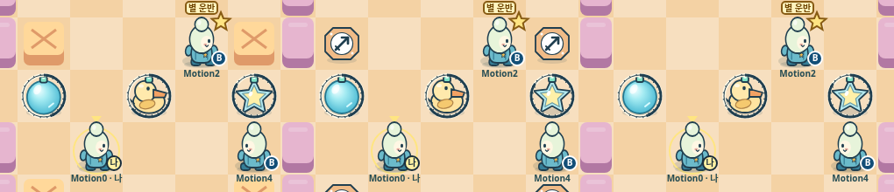

# 벤치마크 08: 전투 동작과 사건을 화면에 잇기

평가일: 2026-11-06. 출발점은 `4f647efe9f2e56ec1d870021b9b7d985c802b838`의 [벤치마크 07](Benchmark-07-Matchmaking-Party.md) **84.625/100**이다. 평가 대상은 브라우저 Canvas의 표현 전용 모션 변경이다. 구현에 참여하지 않은 AI 평가자가 고정 기준, 실제 소스, 실행 로그, 기존 영상에서 추출한 프레임과 새 Chromium 프레임을 읽었다. 영상을 실시간으로 끝까지 재생한 평가나 인간 플레이 테스트로 표현하지 않는다.

**최종 독립 설계 평가: 85.125/100. 출발점보다 +0.5점이며, 고정 평가의 목표 85를 0.125점 넘는다.** 이는 AI 평가자의 휴리스틱 설계 판단이며 서비스 완성률 85.125%를 뜻하지 않는다. 점수는 목표 숫자나 테스트 개수로 정하지 않았으며 반올림으로 목표 달성 처리하지 않는다.

실제 사람 참가자는 **0명**이다. 여덟 자동 브라우저의 일반 참가자 슬롯과 실제 사람을 구분한다. 주관적 재미·편안함·잔존율·대전 밸런스의 실측값이 아니며, 실제 Supabase 프로젝트·공개 HTTPS/WSS·Unity C#/WebGL 빌드는 여전히 미검증이다.

## 고정 기준과 계산

[최초 비교 평가](Competitive-Assessment.md)의 다섯 항목, 비중, 20개 하위 기준과 0~10 척도를 유지한다. 각 항목은 네 하위 점수의 단순 평균이다. 0은 부재, 2는 큰 사용 장애, 5는 기본 경험과 큰 공백, 8은 대체로 일관되고 충분한 경험, 10은 해당 목적에서 뚜렷한 공백이 없는 상태다. 소수점은 계산 재현을 위한 것이며 측정 정밀도를 뜻하지 않는다.

| 항목 | 비중 | 하위 기준 순서 | 출발 하위 점수 | 최종 판단 | 평균 | 가중 기여 /10 |
| --- | ---: | --- | --- | --- | ---: | ---: |
| 완성도 | 25% | 핵심 경기의 끝까지 연결 / 콘텐츠와 사용자 흐름 / 오류·상태 경계의 견고함 / 실제 서비스 준비 | 9 / 9.5 / 9 / 5.5 | 9 / 9.5 / 9 / 5.5 | 8.25 | 2.0625 |
| 재미 | 25% | 설치·회피·연쇄의 순간 판단 / 팀 협력과 구조 / 전략·반복 플레이 변주 / 행동 결과의 피드백 | 8.5 / 9 / 9 / 9.5 | 8.5 / 9 / 9 / 9.5 | 9 | 2.25 |
| 독창성 | 20% | 독자 시각·캐릭터 정체성 / 규칙의 차별성 / 기억할 수 있는 제품 약속 / 이용 방식의 차별성 | 8 / 8 / 8.5 / 6 | 8.5 / 8 / 8.5 / 6 | 7.75 | 1.55 |
| 접근성 | 20% | 처음 경기 시작·학습 / 입력 수단 / 정보 가독성·색 외 단서 / 움직임·소리 조절 | 9.5 / 8.5 / 9 / 8 | 9.5 / 8.5 / 9.5 / 8 | 8.875 | 1.775 |
| 타깃 적합성 | 10% | 짧은 세션 / 친구와 함께하기 / 초보자가 연습·실패 후 다시 하기 / 웹·모바일 사용 맥락 | 8.5 / 8.5 / 9.5 / 8.5 | 8.5 / 8.5 / 9.5 / 8.5 | 8.75 | 0.875 |

`8.25×0.25 + 9×0.25 + 7.75×0.20 + 8.875×0.20 + 8.75×0.10 = 8.5125`다. 100점 환산은 **85.125 = 681/8**, 출발점과 차이는 **0.5 = 1/2**, 목표를 넘는 차이는 **0.125 = 1/8**다. 가중치 변경·정규화·올림은 없다.

첫 모션 구현의 잠정 판단은 **84.875**였다. 방향별 캐릭터 표현은 개선됐지만 움직이는 선수의 획득 표식이 사건 원점에 남았고, 기존 모션 선택권의 유지와 장식만으로 다른 점수를 올릴 근거는 부족했다. 후속 증분은 표식을 실제 수신자에 연결하고 서버 퓨즈 비율을 색 외 기하 단서로 보여 준다. 새 실제 프레임을 본 뒤 정보 가독성만 추가 조정했다. 이전 잠정 판단을 최종 결과로 바꾸어 기록하거나 목표 숫자에 맞춰 반올림한 것이 아니다.

## 20개 하위 기준의 개별 판단

| 항목·하위 기준 | 출발 → 최종 | 판단 근거와 제한 |
| --- | ---: | --- |
| 완성도 · 핵심 경기의 끝까지 연결 | 9 → 9 | 실제 입장·경기·결과·전원 준비 재경기와 새로고침 복귀를 유지한다. 모션은 기존 흐름의 표현 개선이며 새 경기 경로로 중복 가산하지 않는다. |
| 완성도 · 콘텐츠와 사용자 흐름 | 9.5 → 9.5 | 기존 캐릭터·외형·맵·훈련·파티를 유지한다. 방향별 자세와 사건 종류를 새 캐릭터나 콘텐츠 모드 수로 세지 않는다. |
| 완성도 · 오류·상태 경계의 견고함 | 9 → 9 | 모션은 스냅샷을 변경하지 않고 수신 공백·설정 변경·연결·탭·새 경기 경계에서 재기준화한다. 새 기능이 가져온 위험을 처리한 것으로 판단하며 기존 서버 장애 복원·분산 일관성 공백은 남는다. |
| 완성도 · 실제 서비스 준비 | 5.5 → 5.5 | 새 이미지와 검증 소스의 일치·비루트 실행·작성자 잠금·재시작은 배포 산출물의 회귀 근거다. 공개 서비스·실제 Supabase·백업·운영 관측 증거가 새로 생긴 것은 아니다. |
| 재미 · 설치·회피·연쇄의 순간 판단 | 8.5 → 8.5 | 확정 셀 사이 이동과 방향·퓨즈 긴박감이 더 잘 드러난다. 실제 선택·판정·타이밍은 같으며 회피·판단 성공률의 개선은 측정하지 않았다. 새 퓨즈 정보의 읽기 가능성은 접근성에만 반영한다. 부드러운 표현을 새 전술로 세지 않는다. |
| 재미 · 팀 협력과 구조 | 9 → 9 | 구출 자세·문구와 패스 경로를 보강했다. 협동 보상·역할·실제 구출 규칙은 기존과 같고 사람이 구조 기회를 더 잘 알아차리는지는 미측정이다. |
| 재미 · 전략·반복 플레이 변주 | 9 → 9 | 세 판·기존 맵 기믹·하모니 선택을 유지한다. 장식 효과나 보간을 새 전략 변주로 가산하지 않는다. |
| 재미 · 행동 결과의 피드백 | 9.5 → 9.5 | 획득 반짝임·종류 문구, 구출의 팔 들기, 복귀 표시와 다트/패스 경로가 실제 사건에 연결된다. 이미 높은 기존 점수에서 10을 줄 만큼 공백이 없어지지는 않았다. 수집 위치에 남던 표시를 실제 수신자에 연결했지만 같은 셀 선수 이름은 여전히 겹칠 수 있다. 밀집 경기에서 원인·대상·결과를 모두 이해하는지는 미측정이다. |
| 독창성 · 독자 시각·캐릭터 정체성 | 8 → 8.5 | 기존 독자 외형에 앞·뒤·좌·우의 다른 얼굴/몸과 걷기·멈춤·감금·구출·복귀 자세가 붙어 실제 플레이의 캐릭터 표현이 일관돼졌다. 정적 카드의 재사용을 가산한 것이 아니다. 캐릭터별 성격을 드러내는 고유 행동과 깊은 애니메이션 연출은 남는다. |
| 독창성 · 규칙의 차별성 | 8 → 8 | 서버 규칙은 같다. 익숙한 보간·입자·탄성 표현을 장르 규칙의 발명으로 세지 않는다. |
| 독창성 · 기억할 수 있는 제품 약속 | 8.5 → 8.5 | 기존 “구하고, 패스하고, 다시 한 판”의 전달을 보강한다. 새로운 제품 약속이나 사람의 회상·추천 자료는 없다. |
| 독창성 · 이용 방식의 차별성 | 6 → 6 | 웹 즉시 플레이·친구·AI·공유 방식은 같다. 모션 추가 자체가 경쟁작 대신 선택할 독점적 이용 방식은 아니다. |
| 접근성 · 처음 경기 시작·학습 | 9.5 → 9.5 | 훈련 설명과 시작 조건을 유지하고 단계 전환을 가짜 구출/피격으로 재생하지 않는다. 첫 학습 흐름이나 무도움 학습 결과를 새로 입증하지 않았다. |
| 접근성 · 입력 수단 | 8.5 → 8.5 | 키보드·터치·키 변경을 유지한다. 모션은 표현이며 새 입력 수단이나 입력 지연 감소가 아니다. |
| 접근성 · 정보 가독성·색 외 단서 | 9 → 9.5 | 서버 퓨즈의 남은 비율을 고정 원호·길이가 다른 눈금으로 보여 준다. 실제 세 스킨의 시차 설치에서 서로 다른 비율이 full/calm/minimal에 남아, 움직임이나 색을 비교하지 않고도 잔여 퓨즈를 구분할 새 정보가 생겼다. 피격·+2·B·위험 셀도 읽힌다. 작은 실기기에서 눈금 판독, 연쇄 폭발의 더 이른 위험 이해, 밀집 인간 경기·비시각 접근성은 미검증이므로 10은 아니다. |
| 접근성 · 움직임·소리 조절 | 8 → 8 | 기존 full/calm/minimal·모션 줄이기를 새 표현 전체에 적용하고 설정 전환 때 과거 사건을 재생하지 않는다. 기존 선택권의 올바른 확장이며 새 조절 기능이나 편안함의 인간 자료는 없다. |
| 타깃 적합성 · 짧은 세션 | 8.5 → 8.5 | 기존 단판 길이·매칭·다음 경기 동선은 같다. 애니메이션 개수는 세션 시간을 줄이지 않는다. |
| 타깃 적합성 · 친구와 함께하기 | 8.5 → 8.5 | 여덟 자동 참가자로 구출·패스·복귀·재경기를 수행했다. 실제 친구의 다기기 합류나 자발적 재경기 증거로 확대하지 않는다. |
| 타깃 적합성 · 초보자가 연습·실패 후 다시 하기 | 9.5 → 9.5 | 단일 브라우저와 서버 AI 7명의 실제 연습에서 이동·설치·폭발을 확인했다. 연습·실패 후 재시도 조건은 기존과 같고 초보 자신감은 미측정이다. |
| 타깃 적합성 · 웹·모바일 사용 맥락 | 8.5 → 8.5 | 390×844 설정과 130% 글자의 기존 모바일 경로를 유지한다. 실제 390×844 viewport 캡처에서 경기장과 일곱 조작을 함께 확인했다. 기존 모바일 수준을 유지한 증거다. 실기기 터치·배터리·다른 브라우저는 남는다. |

기존 모션의 시각적 개선은 독자 캐릭터 표현에, 후속 퓨즈 게이지의 새로운 비색상 정보는 정보 가독성에 각각 반영했다. 같은 효과의 구현 사실을 피드백·순간 판단·접근성·서비스 준비에 연쇄 가산하지 않는다. 새 기능의 회귀 방지는 가치가 있지만 테스트 증가 자체가 기존 9점 이상 항목의 상승 근거는 아니다.

## 실제 프레임과 실행 조건

[최종 검증 명령·결과·해시](evidence/motion85/verification.json), [여덟 브라우저 원자료](evidence/motion85/report.json), [서버 상태·사건 시점](evidence/motion85/milestones.json), [단일 브라우저 원자료](evidence/motion85/solo/report.json), [선별 프레임의 관찰 범위](evidence/motion85/visual-review.json)를 보관한다. 평가자는 실행 요약에 더해 실제 로그·소스·주요 PNG를 읽었으며, 제공된 57개 소스 파일·선별 증거·검증 로그 해시를 직접 대조해 불일치가 없음을 확인했다. 평가자가 테스트나 브라우저를 별도로 다시 실행한 것은 아니다.

기존 `movement-and-bomb.webm`의 [0~7.5초 추출 프레임](evidence/motion85/before-baseline-filmstrip.png)과 [새 방향별 프레임](evidence/motion85/after-directions-filmstrip.png)을 직접 보았다. 이전과 같은 외형이 새 경기에서는 앞·옆·뒤를 구별하며, 멈춘 뒤 자세도 안정된다. 최종 소스의 [단일 브라우저 이동 프레임](evidence/motion85/solo/after-walk-filmstrip.png)은 캐릭터가 인접 셀 사이에 있는 실제 중간 위치를 보여 준다. 금색 본인 표식의 픽셀 중심은 rAF **987.9 / 1021.2 / 1054.5 / 1071.3ms**에서 x **86.9894 / 111.1444 / 136.0497 / 147.1333**이다. 색상 분포에 따른 중심 오차가 있으므로 정확한 pose 좌표 측정으로 표현하지 않는다.

첫 증분의 개별 PNG에서 다트 획득 문구·반짝임, 팔을 든 구출 자세, 복귀 표시, 다트 경로와 구출, 패스 전달을 확인했다. 최종 증분에서는 아래 수신자 추적 프레임과 상태 기록으로 해당 동작을 다시 확인했다. [최종 reduced 피격 프레임](evidence/motion85/reduced-hit-02.png)에는 **피격 / +2 / B / 위험 셀**이 동시에 읽힌다. 보호 바늘 소비를 감금이라고 잘못 부르던 문제는 피격으로 수정됐고, 정적 사건 표식이 남은 감금 시간을 덮던 문제는 표식 위치·그리기 순서와 실제 reduced 프레임으로 수정 여부를 확인했다.

첫 증분의 일부 이름 붙은 스크린샷은 해당 사건 이후 상태였다. `full-crate-break.png`만으로 파편의 순간 모습을, `full-death.png`만으로 퇴장 잔상을, `minimal-explosion.png`만으로 활성 위험 셀을 관찰했다고 주장하지 않는다. 소스·단위 검사로 확인한 타임라인과 실제 래스터로 본 모습을 구분한다. 초기 사건 합성 이미지는 대부분 검게 나온 결함이 있어 개별 PNG를 읽었다. 두 번째 증분의 수신자 추적·시차 퓨즈 합성은 실제 프레임들이 들어 있는 것을 확인했다. 영상 추출의 minimal-wave 프레임에서는 활성 위험 셀의 사선 무늬도 직접 보았다. 모든 퇴장 잔상·파편 세부를 실시간으로 식별했다는 주장은 하지 않는다.

[수신자 추적 확대 프레임](evidence/motion85/recipient-detail-filmstrip.png)은 다트 획득 뒤 이동한 선수 위로 문구가 따라가는 것과 구출된 선수가 이동한 뒤에도 구출 표식의 대상이 유지되는 것을 보여 준다. 원본 [획득 프레임](evidence/motion85/full-pickup-05.png)과 [구출 프레임](evidence/motion85/full-rescue-04.png), [복귀 프레임](evidence/motion85/recipient-spawn-follow-04.png)도 함께 보관한다. 렌더러는 ID로 현재 pose를 찾아 표시한다. 이미 죽거나 명단에 없는 선수의 과거 생존 사건 표식 억제는 소스·단위 검사 근거다. 실제 브라우저에서 그 특수한 겹침 경계를 따로 연출했다고 주장하지 않는다.

[퓨즈 확대 프레임](evidence/motion85/fuse-detail-filmstrip.png)은 실제 UI에서 세 스킨을 선택하고 시차를 두어 설치한 뒤 촬영했다. full 관찰 끝의 fuse는 버블/오리/별 순서로 **4/8/12틱**, calm은 **2/6/10틱**, minimal은 **3/7/11틱**이었다. 이는 각 관찰 묶음 끝의 스냅샷 값이며 개별 PNG와 정확히 같은 시각의 값이라고 주장하지 않는다. 각 프레임 묶음의 전후 스냅샷과 rAF 시간이 저장돼 있으며, 원호의 남은 길이가 다른 모습을 직접 확인했다. 원호는 서버의 20틱 기준 값을 그대로 읽으며 로컬 시간이 흐른다고 감소를 추정하지 않는다. 연쇄에 의한 조기 폭발도 가능하므로 안전 시간 보증으로 해석하지 않는다.

[실제 390×844 viewport](evidence/motion85/mobile130-viewport.png)에서 130% 글자, 가로 넘침 없음, 경기장과 일곱 조작의 동시 노출을 직접 확인했다. 전체 페이지 캡처를 viewport 증거로 대신하지 않았다.

브라우저 입력은 실제 UI와 키보드를 사용했고 관찰용 스냅샷·Canvas 읽기 외 게임 상태·시간·판정은 주입하지 않았다. 정상 서버 틱은 100ms다. 여덟 페이지 검사에서 녹화 대상 하나는 full, 나머지 일곱은 low/minimal/reduced를 UI로 선택했다. 다트 드롭은 테스트 서버에 `Server/test/fixtures/dart-drops.mjs`를 preload해 결정적으로 만들었다. 블록 파괴→이동 획득→F 다트→구출은 실제 처리하지만 운영 랜덤 분포의 증거는 아니다.

## 성능과 검증 범위

| 관찰 | 조건과 결과 |
| --- | --- |
| 최종 단일 브라우저 rAF | headless Chromium 한 페이지, full, 녹화 1개, 서버 AI 7명, 공유 호스트. 179 간격·5033.1ms, 중앙값 33.3ms, p95 33.4ms, 최대 150ms, 구간 환산 35.56Hz |
| 최신 여덟 페이지 full rAF | 한 페이지 full 녹화와 일곱 페이지 low/minimal/reduced. 49 간격·5099.9ms, 중앙값 100ms, p95 183.4ms, 최대 216.6ms, 9.61Hz |
| 최신 여덟 페이지 minimal rAF | 같은 다중 페이지 조건. 58 간격·5083.2ms, 중앙값 83.3ms, p95 166.7ms, 최대 200ms, 11.41Hz |
| 새 브라우저 시나리오 | report outcome passed, missingCoverage 0, pageErrors 0. 구출·다트·패스·탈락/복귀·설정·새로고침 복귀·재경기를 실제 입력으로 수행 |
| 전체 자동 검사 | 두 번째 증분 후 577/577, 실패·취소·건너뜀 0. 기존 476개를 포함한 전체 검사이며 숫자 자체를 점수로 환산하지 않음 |
| 독립 코드 검토 | 설정 전환의 과거 효과 재개, 보호 피격의 오표기, 감금 시간 위 표식 겹침 세 P2를 수정. 범위 한정 재검토에서 모두 addressed. 후속 수신자 추적·퓨즈 표시 소스/테스트도 독립 검토에서 accepted, 새 blocker 없음. 문서 통합 검토의 완료 여부와 별개인 소스 검토 결과 |
| 최종 컨테이너 | 이미지 `7b66b79498429a6499fe8a11bc377b0f7aea0febd10ee3cf5fc23a4836f4e3f1`. UID1000, 운영 게스트 거부, AI 파티 시작, 0600 잠금, 동일 볼륨 두 번째 작성자 거절, 정상 종료·재시작. 57파일 해시 일치 |
| 최종 화면 회귀 | experience80 exit 0. 360×640·390×844·844×390·1280×720·1920×1080, 글자 130%, 일곱 터치 대상·설정 보존·모달 입력·한 칸 이동·품질·전체 화면 대체 경로. 페이지 오류 0 |
| 첫 증분의 기존 흐름 회귀 | browser·experience80·playability·harmony·reconnect 다섯 명령 exit 0. 소스 해시 `600277dc…02f9fca`에서 실행한 기록이며 최종 두 번째 증분에서 다섯 명령을 모두 재실행한 것으로 표현하지 않음 |

최종 검사와 두 번째 증분 브라우저·화면 회귀·컨테이너는 동일한 아래 소스 해시에 대응한다. 첫 증분의 다섯 회귀 결과는 별도 출처로 남겼다.

간격 측정 중에는 PNG를 수집하지 않았다. 이것은 rAF 간격이며 renderer CPU 소요시간·60fps 보장·최대 서비스 수용량이 아니다. 여덟 페이지 측정의 낮은 cadence를 숨기지 않지만, 그 수치를 일반 이용자 한 기기의 성능으로 일반화하지 않는다. 단일 페이지 측정도 공유 호스트·headless·녹화 조건이며 실기기 성능과 프레임 전달 지연을 추가 검증해야 한다.

평가자가 직접 재계산한 57개 파일 해시는 제공된 [소스 manifest](evidence/motion85/source-manifest.json)와 모두 일치했다. 두 번째 증분 manifest의 aggregate SHA-256은 `d9a46afa206839cb56cdb6895efec75b418c19aa896d5538a335dd782d1c10d3`다. 서버·SQL·게임 규칙에 새로운 성능 개선을 주장하지 않으며 이전 부하·PostgreSQL 검사를 이번에 다시 실행한 것처럼 기록하지 않는다.

## 원작 비교와 남은 증거

| 항목 | 현재 POC | 기존 원작 설계 참조 |
| --- | ---: | ---: |
| 완성도 | 8.25 | 8.5 |
| 재미 | 9 | 8.25 |
| 독창성 | 7.75 | 7.25 |
| 접근성 | 8.875 | 6 |
| 타깃 적합성 | 8.75 | 6 |
| 가중 종합 /100 | **85.125** | **74.375** |

원작 74.375는 최초 평가가 보존한 알려진 PC 버블 대전의 과거 참조상이다. 최신 넥슨 클라이언트의 동작·모션·콘텐츠·이용자 규모를 이번에 시험한 값이 아니다. 이전 공식 사이트 접근이 환경 네트워크 정책으로 거부됐으며 이번에 재시도하거나 우회하지 않았다. 같은 조건의 최신 원작 화면·플레이 자료가 없으므로 동등한 실측 시각 비교나 실제 재미·시장 우위로 해석하지 않는다.

현재 판단이 85를 넘더라도 남은 경험 공백은 사라지지 않는다. 표현 측면에서 다음 증거는 여러 사건이 동시에 겹치는 인간 경기에서 원인·대상·종류가 구별되는지, 작은 화면의 퓨즈 정보와 같은 셀 선수 표식이 실제 판단을 돕는지다. 인간 참가자의 사건 이해·구조 기회 인지·모션 편안함을 관찰하면 현재 자동 검사의 한계를 줄일 수 있다. 캐릭터별 고유 행동이나 새 표현을 추가하더라도 일관성과 구별 가능성이 실제 프레임에서 드러나야 한다.

더 큰 공백인 실제 서비스 준비, 공개 다기기 합류, 인간 대전 밸런스·장기 반복 가치, 실제 모바일 사용은 여전히 별도의 증거가 필요하다. 프레임 수·효과 종류·테스트 수가 그 공백을 대신하지 않는다.
