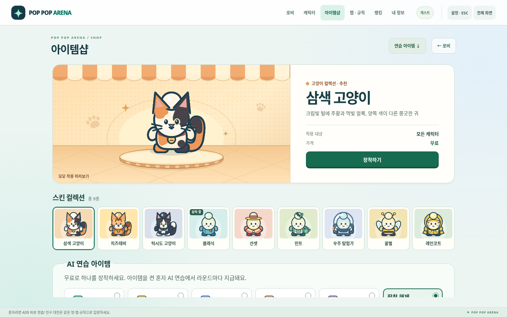

# 고양이 스킨과 AI 연습 아이템샵

로비의 **아이템샵**에서 스킨 미리보기를 고른 뒤 **장착하기**를 누르면 다음 경기부터 입는다. 스킨과 연습 아이템은 모두 무료다. 게스트 착장과 AI 연습 아이템은 기기에 저장된다. 회원의 캐릭터·스킨·물폭탄 외형은 장착하면 계정에 저장되고 다른 기기에서도 복원된다. 아이템샵은 브라우저판에 적용한다.

## 직접 제작한 고양이 스킨

네 캐릭터의 머리 형태를 살리면서 귀, 수염, 꼬리, 의상을 Canvas로 그렸다. 상점, 착장 화면, 경기장, 결과 카드에서 같은 그림 함수를 사용한다. 고양이 피부색과 별도로 경기 중 팀 표식과 상태 효과가 표시된다.

| 스킨 | 식별자 | 작은 경기 화면에서도 보이는 특징 |
| --- | --- | --- |
| 치즈태비 | `tabby` | 주황색 털과 크림색 주둥이, 이마의 M자 무늬, 띠가 있는 꼬리와 방울 |
| 턱시도 고양이 | `tuxedo` | 먹색 털과 흰 가슴·발끝, 나비넥타이 |
| 삼색 고양이 | `cat` | 크림색 바탕에 비대칭 주황·먹색 반점, 색이 다른 두 귀와 꼬리 |

삼색 고양이가 첫 미리보기다. 다른 상품을 눌러 둘러보다 나가면 원래 장착은 유지된다. 기존 착장 화면에서도 스킨을 바꿀 수 있다. 외부 스킨 파일이나 넥슨 그림을 사용하지 않았다. [외형 카탈로그](../../Server/public/cosmetics.js) · [공용 렌더러](../../Server/public/visuals.js)

## 크레이지 아케이드 아이템 조사

원작을 재현한 공개 자료는 물풍선·액체·롤러 스케이트를 각각 설치 개수, 물줄기 길이, 이동 속도를 올리는 필드 아이템으로 분류한다. 같은 자료는 바늘과 다트를 상점 아이템으로 구분한다. 바늘은 물방울에 갇힌 본인이 스스로 빠져나올 때 쓰고, 다트는 멀리 있는 물풍선을 터뜨리는 용도로 설명한다. [아이템별 분류와 설명](https://github.com/anotherwolf7129/BnB/blob/c0d5c74dca9328b74a7f8dbf86f572c6d84670ae/src/sim/items.ts#L45-L79)

별도의 한국판 클라이언트 아이템 목록에서도 바늘과 다트 항목을 확인했고, 다른 재현 프로젝트에서도 갇혔을 때 바늘을 사용하는 조작을 확인했다. 넥슨 공식 사이트는 조사 환경에서 접속이 차단돼 과거 판매 가격이나 현재 판매 여부는 확인할 수 없었다. [클라이언트 아이템 목록](https://github.com/aquaplatinumberlitz/boom-kr-server/blob/e2d15d463c08f34e481c6941ef458bf07aeef22b/docs/CONTENT.md#L439-L442) · [바늘 사용 기록](https://github.com/chorae05/Crazy_arcade/blob/abc394fbb47db94993e449b096a966242c10c687/README.md#L19) · [넥슨 공식 사이트](https://ca.nexon.com/)

## 이 게임의 연습 상품

상점의 **AI 연습 아이템**에서 하나를 선택하거나 장착을 해제한다. 아이템을 켠 단독 AI 연습에 입장하면 서버가 매 라운드 시작 시 사람에게만 지급한다. 친구방과 등급전은 참가자의 시작 조건을 동일하게 유지하고, 단계별 훈련은 수업에 필요한 정해진 장비를 지급한다.

| 상품 | 참고한 아이템 | Pop Pop Arena에서의 효과 |
| --- | --- | --- |
| 여분 물방울 | 물풍선 | 동시에 설치할 수 있는 물폭탄이 1개에서 2개로 늘어난다. |
| 파동 앰플 | 액체 | 물폭탄의 기본 사거리가 방향당 3칸에서 4칸으로 늘어난다. 벽·상자의 차단 규칙은 적용된다. |
| 물결 운동화 | 롤러 스케이트 | 이동 대기 시간이 2틱에서 1틱으로 줄어든다. |
| 구조 다트 | 다트 | 기존 구조 다트 1발로 시작한다. 바라보는 방향으로 발사해 갇힌 아군을 구조할 수 있다. |
| 비상 바늘 | 바늘 | 물방울에 갇히면 **비상 바늘 사용**을 눌러 한 번 탈출한다. 경기장에 키보드 포커스가 있으면 Tab 한 번 후 Enter로 사용할 수 있다. 한 번의 피격을 자동으로 막아 주는 기존 핀과 별개다. |

기본 장착은 해제 상태다. 서버가 허용한 아이템 ID로 지급량과 효과를 결정하며, 연습 아이템 지급이나 바늘 자력 탈출에는 아이템 획득 점수와 팀원 구조 점수를 주지 않는다. 복귀하면 라운드에서 이미 사용한 수량도 그대로 복원한다. [연습 아이템 카탈로그](../../Server/public/practice-items.js) · [실시간 프로토콜](../Architecture/Realtime-Protocol.md)

[실제 AI 연습 아이템 선택 화면](evidence/practice-item-shop.png)

## 검증 기준

- 캐릭터 4종과 스킨 9종의 정면 조합이 서로 구별되고 세 고양이의 옆·뒤 모습도 구별되어야 한다.
- 상점에서 장착한 값이 새로고침과 실제 입장 뒤 서버 상태에 남아야 한다. 모바일 터치와 키보드로 상품을 선택할 수 있어야 한다.
- 연습 장비는 입장 조건, 대상, 새 라운드, 복귀, 바늘 사용 전후 수량을 실제 서버에서 확인한다.
- 검증 브랜치와 `main`에서 동일 커밋의 전체 품질 게이트로 브라우저 3종과 단위·통합 검사를 실행한다. [품질 게이트](../Operations/Quality-Gates.md)
