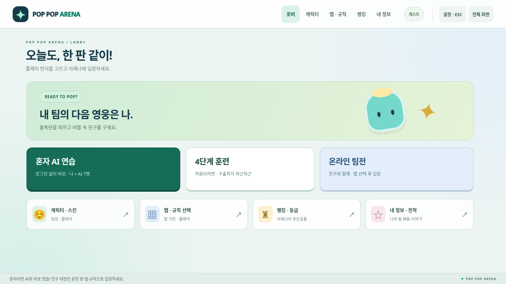

# 공개 플레이 피드백: 화면과 회원 경험 수정

2026-11-07 사용자가 Render에서 직접 실행한 뒤 기존 벤치마킹 평가에 비해 약30점 수준이라고 평가했다. 회원가입/DB 연결의 실제 사용 경로, 화면 분리와 입장 동선, 전체화면에서 사라지는 게임판, 끊기는 이동이 핵심 문제였다. 종전80~85점대 설계 평가는 실제 공개 경험을 대표하지 못했으므로 이번에는 점수를 올려 발표하지 않고 실제 사용 절차와 외부 설정을 구분한다.

## 원인과 변경

| 문제 | 확인한 원인 | 변경 |
| --- | --- | --- |
| 전체화면에서 게임판이 안 보임 | 선택·훈련·도움말까지 포함한 flex column이 게임판 부모의 내용 높이를0으로 줄임. Canvas 자체 크기만 검사하면 놓치는 버그 | 전체 게임 shell을 fullscreen 대상으로 하고 대전 보드/조작만 고정 viewport에 배치. 실제 부모 clipping까지 검사 |
| 모바일 가로 전체화면에서 작은 게임판 | 일반 fullscreen CSS가 가로 배치 크기보다 우선함 | 남은 보드 영역을 기준으로 aspect ratio를 계산하는 전용 grid/container 배치 |
| 게임을 찾기 위해 페이지 스크롤 | 기존1280×720에서 문서 높이2802px. 메뉴·선택·전투가 한 흐름에 존재 | 시작, 로그인, 로비, 캐릭터, 맵, 연결/대기, 대전, 결과, 내 정보, 랭킹을 별도 화면으로 분리 |
| 한 칸마다 멈추는 이동 | 기본 서버 이동200ms/가속100ms인데 모든 표현을80ms에 끝냄. 이른 다음 상태에서 중간 위치가 점프함 | 관측된 서버 tick과 이동 cooldown에 맞춘 보간. 확인된 경로의 모서리를 유지하고 순간이동/재접속은 즉시 반영 |
| 회원가입·계정 유지 없음 | 기존 클라이언트는 익명 가입 경로만 제공 | 이메일 가입/확인 안내/로그인/갱신/로그아웃, 기기 내 세션 유지와 다시 로그인하여 같은 계정 사용 |
| 내 기록을 볼 화면 없음 | 집계·랭킹 서버 코드는 있었으나 회원별 조회 API/UI가 없음 | JWT 검증 후 본인 프로필·전적·순위·최근 경기·결제내역 조회, 닉네임 수정 |

화면 선택은 기존 캐릭터/스킨/맵 렌더러를 재사용한다. 대전은 서버의 실제 joined/state 응답으로 진입하며 준비 화면만 가짜로 재생하지 않는다. 기다리기·취소·나가기·재대결과 훈련 이어하기도 해당 서버 연결 상태에 따라 이동한다. 긴 회원 기록·랭킹·설정은 그 패널 안에서만 스크롤한다.

회원 비밀번호는 Supabase Auth에 전송하며 게임 서버/DB에 별도로 저장하지 않는다. 점수·등급은 기존 서버 결과 집계만 변경한다. 공개 프로필/랭킹을 제외한 본인 경기·결제내역은 API뿐 아니라 DB RLS로 제한한다. 결제 테이블은 내역 metadata용이며 실제 구매/청구/카드 저장 기능은 없다. 이는 사용자가 확인한 범위다.

## 검증 기록

- 전체 Node 서버/helper 회귀 테스트642개 통과. Unity JavaScript bridge2개와 GitHub 변경 guard5개 통과.
- 실제 격리 PostgreSQL에서 기존 랭킹/팀 Elo/동시 결과 집계와 새 회원 마이그레이션을 검사했다. 타인·익명 회원의 내역 접근, 클라이언트 결제 쓰기·점수 변경을 제한한다.
- 이동의 결정적100/200ms 표본에서는 정상 이동의 정지 표본60%→0%, 가속20%→0%, 이른 방향 전환의 위치 점프0.375칸→0을 확인했다. 이는 로컬 표현 모듈 검사이며 실제 인터넷 지연이나 프레임 성능 측정이 아니다.
- `python3 scripts/game-shell-smoke.py`의9시나리오가 한 번의 최종 실행에서 모두 통과했다. 1440×900/1280×720/390×844/844×390에서 스크롤·부모 clipping·실제 fullscreen·native ESC·설정, 회원 입장 경계, 키 변경/음향 조작, 두 종류 훈련, 실제4단계 훈련2회 완료 후 결과/재훈련/AI 이어하기, 실제2브라우저 결과/재경기, 실제8브라우저4대4를 검사했다.
- `python3 scripts/member-account-smoke.py --race all`의9검증 항목이 통과했다. 실제 Node API와 로컬 Supabase 프로토콜 fixture를 통과하는 가입 확인 안내·로그인 오류/성공·자연 만료 후 갱신·닉네임/전적/결제내역·온라인 이름·로그아웃을 검사했다. 첫 설정 요청503 후 같은 회원/방 복귀, 지연된 로그아웃 응답 뒤 새 대전 화면 유지도 재현 실패→수정 성공을 확인했다.
- 64접속/8방/60초 로컬 부하 검사는 종료 후 연결0/방0을 확인했다. 로컬 ping RTT p95는3.94ms이며 실제 인터넷 지연 수치가 아니다.
- 독립 검토가 찾은3건(복구 설정 초기화, 지연 로그아웃 화면 전환, 훈련 결과/재훈련 누락)은 각각 회귀 검사 후 재검토에서 해결 판정을 받았다.

기존 개별 browser smoke들은 한 페이지·스크롤 UI를 전제로 했다. 현재 CI는 새 화면에서 실제 버튼을 누르는 게임/회원 acceptance로 교체하며, 전투·아이템·재접속·등급전·파티·음향 규칙은 전체 Node 회귀 테스트를 계속 실행한다. 이전 UI 스크립트 통과를 이번 버전의 검증으로 주장하지 않는다.

## 실제 활성화에 필요한 설정

현재 개발 환경에는 운영 Supabase 또는 Render 계정 인증이 없다. 제공된 `https://poppop-arena.onrender.com/`은 개발 환경의 네트워크 정책에서403으로 차단되어 공개 서비스 동작을 여기서 확인하지 못했다.

운영에서는 [README Supabase 설정](../../README.md#supabase-설정)의 네 마이그레이션과 Email 인증/Site URL, Render의 서버 환경변수3개를 적용해야 한다. 회원/전적 조회와 실제 메일 확인은 해당 프로젝트에서 검증해야 한다. 결제내역 화면 구현은 결제 서비스 연결 완료를 뜻하지 않는다. Render 무료 데모는 재시작 시 메모리 경기와 임시 파일이 사라지므로 랭킹 운영의 미전송 결과 복구에는 영속 저장 구성이 필요하다.

로그인/공개 서버/실제 사람8명 플레이와 사용자의 재평가가 완료되기 전에는 서비스 완성도나 재미 점수를 다시 부여하지 않는다.

## 변경된 실제 화면

[시작](evidence/game-shell-accounts/title.png) · [로비](evidence/game-shell-accounts/lobby.png) · [PC 대전](evidence/game-shell-accounts/battle-desktop.png) · [모바일 대전](evidence/game-shell-accounts/battle-mobile.png)

[기계 검증 요약](evidence/game-shell-accounts/verification.json)에 공개/로컬 범위를 함께 기록했다.
