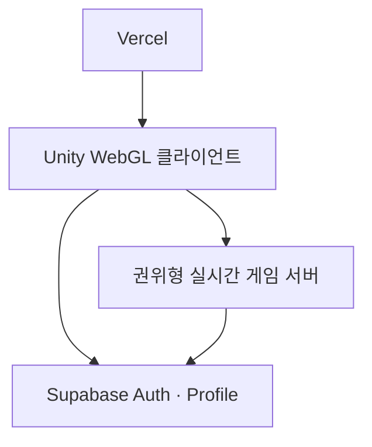

# Pop Pop Arena — MVP 게임 설계 v0.1

> 코드명 **Pop Pop Arena**. 최종 서비스명과 IP 자산 확정 전까지 쓰는 중립적 이름이다.

## 1. 제품 한 줄

귀여운 탐험대가 **팝 오브(Pop Orb)**를 설치해 길을 열고 상대를 버블에 가두는, 2~3분 길이의 모바일 실시간 캐주얼 대전 게임.

## 2. 타깃과 경험 원칙

- **주 타깃:** 10~20대, 어린이와 여성 사용자가 부담 없이 시작할 수 있는 캐주얼 대전층.
- **플레이 시간:** 매칭부터 결과까지 3분 이내. 패배 후에도 즉시 재대결 또는 다음 매치 진입.
- **조작:** 왼쪽 가상 스틱 이동 + 오른쪽 큰 `팝 오브` 버튼 하나. PC WebGL은 방향키/WASD + Space.
- **정서:** 위협·폭력보다 장난스럽고 명랑한 버블, 반짝임, 구조 연출을 사용한다.

## 3. 계승할 장점과 독자 IP 분리

| 계승할 플레이 장점 | Pop Pop Arena의 독자적 구현 |
| --- | --- |
| 즉시 이해되는 격자 이동과 설치형 함정 | 팝 오브를 설치하면 일정 시간 뒤 4방향 `팝 웨이브`가 퍼진다. |
| 블록 파괴와 길 열기의 쾌감 | `솜구름 상자`를 깨면 길과 아이템이 열린다. |
| 연쇄 반응의 전술성 | 웨이브가 다른 팝 오브를 즉시 점화한다. |
| 아이템으로 만드는 역전 | 오브 수, 웨이브 길이, 이동, 버블 탈출을 직관적으로 강화한다. |
| 상대의 이동 예측과 가두기 | 통로·모서리·블록을 활용한 짧은 심리전으로 설계한다. |
| 팀 협동·구출의 재미 | 팀전에서 버블 상태 아군을 접촉해 구조할 수 있다. |
| 맵별 변주 | 레일, 젤리 바닥, 바람길처럼 하나의 읽기 쉬운 기믹만 맵마다 둔다. |

원작을 식별하게 하는 명칭, 캐릭터, 맵, 그래픽, 사운드, UI와 고유 에셋은 사용하지 않는다. 위 표는 장르의 일반적인 플레이 구조만 정의한다.

## 4. MVP 범위

### 출시 전 첫 플레이 가능 버전 (P0)

- 13×11 타일, 단일 아레나, 로컬 1~2인 테스트.
- 이동, 파괴 블록, 팝 오브 설치, 4방향 웨이브, 연쇄 점화, 버블 상태, 승패.
- 기본 강화 4종: `오브+`, `웨이브+`, `대시`, `핀(탈출)`.
- 120초 타이머와 서든 팝 존(가장자리부터 안전 구역 축소).
- 임시 도형과 색상만 사용. 상용 에셋은 포함하지 않는다.

### 온라인 MVP (P1)

- 2인 빠른 매칭, 비공개 초대방, 재접속, 간단한 전적.
- 권위형 실시간 게임 서버가 좌표, 설치, 충돌, 웨이브, 피해와 결과를 판정한다.
- Supabase는 로그인·닉네임·전적·랭킹·보유 꾸미기 데이터만 관리한다.

### 첫 공개 버전 (P2)

- 1v1 랭크전, 2v2 일반전, 3개 맵, 4개 기본 캐릭터, 스킨과 이모트.
- 어린이 사용자 보호를 위한 간편 신고, 이름 필터, 공개 채팅 미제공.

## 5. 경기 규칙

1. 1v1은 각자 안전 구역에서 시작한다.
2. 플레이어는 현재 최대 수만큼 팝 오브를 설치할 수 있다.
3. 팝 오브는 2초 뒤 십자 웨이브를 낸다. 단단한 벽은 막고, 솜구름 상자는 한 칸에서 소멸한다.
4. 웨이브에 닿으면 플레이어는 버블 상태가 된다. 솔로전은 2초 뒤 탈락, 팀전은 아군 구조가 가능하다.
5. 제한 시간 종료 시 안전 구역을 강제로 줄여 결판을 낸다.

## 6. 기술 설계

- **Unity:** Unity 6 LTS, URP 없이 시작하는 경량 3D/아이소메트릭 표현. 전투 좌표와 충돌은 2D 정수 격자다.
- **WebGL / Vercel:** Unity WebGL 빌드 산출물과 랜딩·초대 링크를 배포한다.
- **Supabase:** Auth, Postgres(프로필·전적·랭킹·꾸미기), Realtime은 로비·알림 보조 용도에 한정한다.
- **실시간 서버:** 룸 상태를 보유하고 tick 단위로 판정한다. 클라이언트는 입력만 전송하며 결과를 임의로 확정하지 않는다.

## 7. 아트 가이드 (후속 IP 자산 제작 기준)

- 둥근 실루엣, 파스텔 고명도, 2~3색 중심의 명료한 가독성.
- 적대적 폭발 대신 비눗방울·종이조각·별빛 같은 `팝` 연출.
- 캐릭터 능력치는 랭크 공정성을 위해 동일하게 유지하고, 차이는 외형·이모트·승리 연출로 제공한다.

## 8. 개발 마일스톤

| 단계 | 완료 조건 |
| --- | --- |
| M0 — 완료 | 이 문서와 Unity 로컬 전투 골격이 존재한다. |
| M1 — 진행 중 | 2인이 한 기기/에디터에서 오브·버블·아이템·타이머가 있는 한 판을 끝낼 수 있다. |
| M2 | 실제 서버 2인 매치와 Supabase 로그인·전적 기록이 동작한다. |
| M3 | 독자 IP 아트, 랭크, 초대 링크가 포함된 비공개 테스트가 가능하다. |
